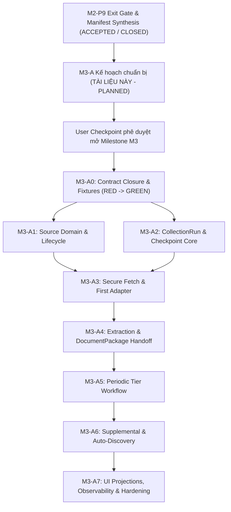

# Gói Chuẩn Bị Thực Thi Kỹ Thuật: M3-A (Phân Hệ A - Nguồn & Thu Thập Nội Dung)

> **Mã định danh gói (Package ID):** `M3-A` (Chuyển tiếp từ `M3-A-TEMPLATE`)
> **Milestone liên quan:** `M3` - Thu thập và kho nội dung (`R1 Content Alpha`)
> **Trạng thái thẩm quyền (Authority State):** `planned` (Chuẩn bị kế hoạch thực thi kỹ thuật; cấm triển khai mã nguồn sản phẩm khi chưa có User Checkpoint phê duyệt mở Milestone M3)
> **Phân hệ sở hữu (Owner):** Phân hệ A (`a-source-collection` / cloud worker `source_ingestion`)
> **Thời điểm xác lập:** 09-10-2026 (Sau khi M2-P9 đạt Astra PASS và hợp nhất tại commit `1aedf8fc2c1e90b34b5db8f0c01e28c8003f781e`)
> **Tài liệu nguồn thẩm quyền:**
> - [docs/11-roadmap.md](../11-roadmap.md) (Mục 9, 14, 16, 23)
> - [docs/12-pre-code-checklist.md](../12-pre-code-checklist.md) (PCC-018, PCC-019, PCC-027, PCC-029)
> - [docs/modules/a-source-collection/spec.md](../modules/a-source-collection/spec.md)
> - [docs/modules/a-source-collection/implementation-plan.md](../modules/a-source-collection/implementation-plan.md)
> - [docs/06-system-map.md](../06-system-map.md) (Phân hệ A)
> - [docs/08-architecture.md](../08-architecture.md) (Module `source_ingestion`)
> - [docs/parallel-delivery/operating-model.md](./operating-model.md)
> - [docs/parallel-delivery/ownership-and-locks.yaml](./ownership-and-locks.yaml)
> - [docs/parallel-delivery/task-dag.yaml](./task-dag.yaml)

---

## 1. Mục Đích và Giới Hạn Của Gói Chuẩn Bị M3-A

Gói chuẩn bị thực thi `M3-A` thiết lập toàn bộ cơ sở kỹ thuật machine-readable và human-readable cho Phân hệ A trước khi bước vào chu trình TDD (Test-Driven Development).

### 1.1. Phạm vi thực hiện
- Định nghĩa ranh giới sở hữu mã nguồn, aggregate và đường dẫn tệp tin cụ thể (`src/source_ingestion/**`, `tests/unit/collection/**`, `tests/integration/collection/**`).
- Khóa chặt các phiên bản hợp đồng (Contract Freeze) với SHA-256 bất biến từ `contract-registry.yaml`.
- Thiết lập bản đồ dependency, ma trận khóa tài nguyên (Resource Locks & Leases), chính sách rollback an toàn không làm hỏng evidence của M1/M2.
- Định vị chính xác các điểm kiểm tra hỏng hóc hành vi (Behavioral RED Oracles) cho từng gói công việc nhỏ A0..A7.

### 1.2. Giới hạn nghiêm ngặt (Fail-Closed Boundaries)
- **Tuyệt đối không sửa đổi mã nguồn sản phẩm (Product Source):** Không tạo hoặc chỉnh sửa bất kỳ tệp nào trong `src/**`.
- **Tuyệt đối không sửa đổi database migration:** Không chạm vào `migrations/**` hoặc `src/**/migrations/**`.
- **Tuyệt đối không ghi đè evidence lịch sử:** Không chạm vào `docs/milestones/**/evidence/**` của M1 (P0..P6) và M2 (P0..P9).
- **Trạng thái thực thi:** Triển khai mã nguồn sản phẩm và migration vẫn tiếp tục bị **KHÓA CHẶT** (`NOT AUTHORIZED`) theo quy định tại `docs/12-pre-code-checklist.md` cho đến khi có User Checkpoint chính thức kích hoạt Milestone M3.

---

## 2. Tiền Đề Kỹ Thuật & Đồ Thị Phụ Thuộc (DAG Dependencies)

### 2.1. Điều kiện tiền đề kỹ thuật (Technical Preconditions)
1. **M2-P9 Hoàn tất:** Candidate HEAD `1aedf8fc2c1e90b34b5db8f0c01e28c8003f781e` đạt Astra PASS, kiểm tra hồi quy M1 (93/93 tests PASS), kiểm tra tích hợp M2 hoàn tất, secret scan 0 finding.
2. **Hạ tầng cơ sở từ M2:**
   - Envelope chuẩn (`CommandEnvelope`, `QueryEnvelope`, `EventEnvelope`, `ProblemDetail`).
   - Transactional Outbox pattern và PostgreSQL connection pooling (`psycopg_pool.ConnectionPool`).
   - SQLite local journal và atomic write protocol.
   - Secret Management Broker cô lập OS subprocess và Windows DPAPI.
   - Admin UI shell và SSE event stream.

---

## 3. Ranh Giới Sở Hữu Mã Nguồn (Single-Writer Ownership & Source Paths)

Tuân thủ nguyên tắc Single-Writer tại `docs/parallel-delivery/ownership-and-locks.yaml`: Phân hệ A là người ghi duy nhất (Single-Writer) vào các aggregate và đường dẫn được phân quyền.

### 3.1. Aggregates thuộc quyền sở hữu của Phân hệ A
- `SourceCandidate`: Thực thể đề xuất nguồn từ auto-discovery hoặc nhập liệu thủ công.
- `Source`: Thực thể nguồn tin đã đăng ký, có phiên bản metadata và trạng thái hoạt động.
- `CollectionRun`: Thực thể đại diện cho một lượt quét thu thập từ một nguồn cụ thể.
- `CollectionAttempt`: Lần thử thực thi trong một run theo cơ chế retry có ngân sách.
- `CollectedDocument`: Gói tài liệu thu thập được (`CollectedDocumentPackage`) trước khi bàn giao sang B.
- `SourceTombstone`: Bản ghi vĩnh viễn đánh dấu nguồn bị xóa để chống auto-discovery thêm lại.

### 3.2. Cấu trúc thư mục mã nguồn cụ thể (Target Specific Source Paths)

Khi được cấp quyền implementation, mã nguồn Phân hệ A sẽ được bố trí theo cấu trúc modular monolith:

| Đường dẫn dự kiến | Vai trò kiến trúc | Ranh giới sở hữu |
|---|---|---|
| `src/source_ingestion/__init__.py` | Module entry point | Thuộc quyền exclusive của A |
| `src/source_ingestion/domain/models.py` | Thực thể Source, Run, Attempt, Package | Domain logic thuần, không I/O |
| `src/source_ingestion/domain/lifecycle.py` | State machines CT-STATE-001, 002, 002A | Enforce bất biến trạng thái |
| `src/source_ingestion/domain/ssrf_guard.py` | Kiểm tra an toàn URL, chống SSRF/DNS rebinding | Security boundary thuần túy |
| `src/source_ingestion/application/commands.py` | Command handlers: Register, Update, Remove, Restore | Application layer có idempotency |
| `src/source_ingestion/application/collection_service.py` | Điều phối fetch, extraction, package building | Orchestration nội bộ module A |
| `src/source_ingestion/application/candidate_service.py` | Đánh giá và đăng ký candidate theo CT-SRC-003A | Xử lý auto-discovery |
| `src/source_ingestion/ports/inbound.py` | Inbound interfaces cho Control API / Admin UI / G | Typed interface contracts |
| `src/source_ingestion/ports/outbound.py` | Outbound ports cho Storage (I), Content (B), Config (J) | Typed dependency inversion |
| `src/source_ingestion/adapters/http_client.py` | HTTP fetch adapter tuân thủ SSRF guard | Network boundary có timeout/retry |
| `src/source_ingestion/adapters/rss_adapter.py` | Parser chuyên biệt cho RSS/Atom feeds | Trích xuất tin tức chuẩn |
| `src/source_ingestion/adapters/web_scraper_adapter.py` | Parser HTML cho web tin tức tổng hợp | Trích xuất DOM và metadata |
| `src/source_ingestion/infrastructure/db/repositories.py` | Repository persistence qua PostgreSQL UoW | Transaction boundary A |
| `src/source_ingestion/infrastructure/outbox.py` | Producer transactional outbox events | At-least-once domain events |
| `tests/unit/collection/**` | Bộ kiểm thử unit cho domain, SSRF, adapters | Phân hệ A sở hữu |
| `tests/integration/collection/**` | Bộ kiểm thử tích hợp DB UoW, transactional race | Phân hệ A sở hữu |

### 3.3. Ranh giới cấm ghi (Strictly Forbidden Cross-Owner Paths)
- Tuyệt đối không ghi vào các bảng của B: `articles`, `article_revisions`, `events`, `event_updates`.
- Tuyệt đối không ghi vào các bảng của C: `media_assets`, `media_usage`, `hooks`.
- Tuyệt đối không ghi vào bảng của G: `batches`, `jobs`, `stage_runs`, `completion_ledgers`.
- Giao tiếp liên phân hệ bắt buộc đi qua:
  1. Handoff `CollectedDocumentPackage` sang B qua Outbox Event / Domain Interface.
  2. Báo cáo trạng thái `CollectionRun` về G qua `ActivityResult` và Outbox Event.
  3. Yêu cầu lưu snapshot raw byte qua Storage Port của I và nhận `ArtifactRef`.
  4. Lấy cấu hình adapter và thông tin quota từ J qua Config Port.

---

## 4. Quản Lý Khóa Tài Nguyên & Fencing (Resource Locks & Leases)

Theo mô hình `ownership-and-locks.yaml` và `operating-model.md`:

| Tên Khóa (Lock ID) | Kiểu khóa (Type) | Mục đích bảo vệ | Fencing Token & Rule |
|---|---|---|---|
| `LOCK-CONTRACT-SOURCE-CONTENT` | Exclusive Contract Lock | Bảo vệ tính bất biến của hợp đồng nguồn CT-SRC-* và CT-CNT-* | Đóng băng ở SHA-256 xác định; không writer nào được sửa |
| `LOCK-SRC-SOURCE-INGESTION` | Exclusive Path Lock | Bảo vệ mã nguồn `src/source_ingestion/**` | Cấp cho worker implementer trong suốt ca làm việc |
| `LOCK-POSTGRES-TEST-DB` | Exclusive by DB namespace | Cách ly database thử nghiệm (ví dụ `db:m3_collection_test`) | Disposable database function/run-scoped; dọn dẹp sạch sau test |
| `LOCK-MIGRATION-SEQUENCE` | Serialized Migration Lock | Khi tạo migration `0009` cho các bảng của Module A | Single-writer tuần tự qua merge queue; cấm tạo song song |

---

## 5. Chiến Lược Rollback & Bảo Toàn Dữ Liệu (Rollback Strategy)

1. **Rollback ở mức mã nguồn:**
   - Git revert nguyên tử commit ứng viên.
   - Worktree biệt lập ngăn ngừa ô nhiễm nhánh chính.
2. **Rollback ở mức cơ sở dữ liệu:**
   - Mỗi migration script của Phân hệ A (dự kiến `0009_source_collection.py`) bắt buộc có phương thức `down()` tương ứng hoàn chỉnh.
   - Kiểm thử rollback migration tự động trong sandbox trước khi đưa vào merge queue.
3. **Bảo toàn Evidence bất biến (Preserves Accepted Evidence):**
   - Không được chạm vào hoặc làm thay đổi hash của:
     - `docs/milestones/m1-proof/evidence/**`
     - `docs/milestones/m2-control-plane/evidence/**`
   - Bất kỳ vi phạm nào đối với evidence đã được nghiệm thu sẽ kích hoạt trạng thái `FAIL` fail-closed ngay lập tức.

---

## 6. Danh Mục Open Items & Hạn Quyết Định (Open Decision Gates)

Trước khi kích hoạt sản xuất (`production_activation_authorized`), các điểm kỹ thuật sau phải được chốt qua Config Revision từ Module J hoặc quyết định chính thức:

| Mã Open Item | Nội dung kỹ thuật | Phạm vi ảnh hưởng | Hạn chốt bắt buộc |
|---|---|---|---|
| `ROADMAP-OPEN-004` | Múi giờ chính thức cho chu kỳ quét định kỳ (`business_date`) | Lập lịch cycle định kỳ trong CT-SRC-004 | Trước khi kích hoạt scheduler tự động |
| `QUALITY-OPEN-002` | Thời gian chạy tối đa cho một chu kỳ thu thập hàng ngày | Ngân sách timeout và deadline trong CT-SRC-005 | Trước khi nghiệm thu gate hiệu năng G02 |
| `QUALITY-OPEN-005` | Cơ chế proxy cho trending / hot content discovery | Adapter web scraper trong A6 | Trước khi nghiệm thu content selection |
| `POLICY-SRC-001` | Tiêu chí phân loại Tier 1 / 2 / 3 và ngưỡng tin mới không trùng theo chủ đề | `PlanCollectionCycle` (CT-SRC-004) | Cung cấp qua `ConfigRevision` từ J; không hardcode |
| `POLICY-SRC-002` | Quy tắc bắt buộc title đối với từng loại nguồn tin (web vs social) | Validation lớp 2 trong CT-SRC-006 | Cung cấp qua chính sách adapter; không mặc định |
| `USER-CKPT-M3` | Checkpoint phê duyệt chính thức mở Milestone M3 từ Người dùng | Chuyển trạng thái từ `planned` sang `implementation_authorized` | Điều kiện tiên quyết tuyệt đối trước dòng code đầu tiên của M3 |

---

## 7. Kết Luận & Định Hướng Tiếp Theo

Gói chuẩn bị `M3-A` đã hoàn tất việc đóng khung ranh giới kỹ thuật, ánh xạ 100% tài liệu thẩm quyền hiện hành, khóa bất biến các hợp đồng giao tiếp và thiết lập lộ trình kiểm thử test-first nghiêm ngặt. Hệ thống sẵn sàng cho bước thẩm tra kỹ thuật read-only từ Sol-Lead và Astra-Lead.
