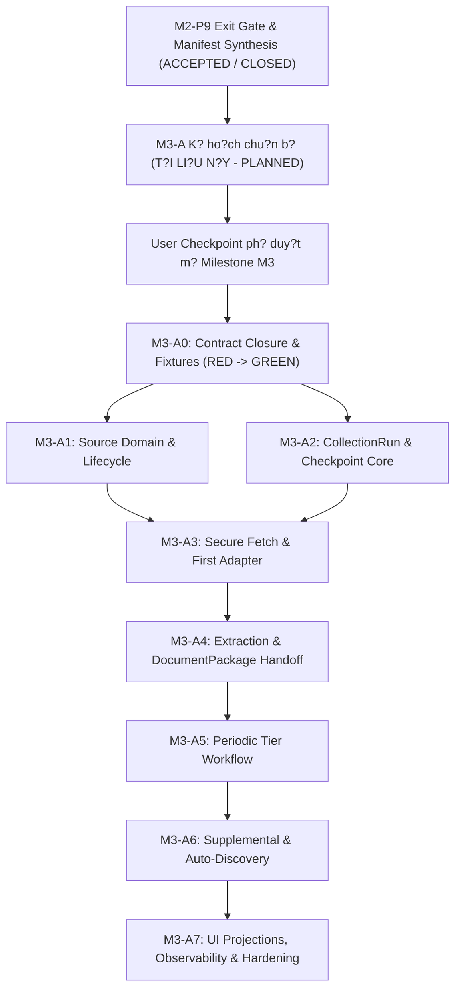

# G?i Chu?n B? Th?c Thi K? Thu?t: M3-A (Ph?n H? A ? Ngu?n & Thu Th?p N?i Dung)

> **M? ??nh danh g?i (Package ID):** `M3-A` (Chuy?n ti?p t? `M3-A-TEMPLATE`)
> **Milestone li?n quan:** `M3` ? Thu th?p v? kho n?i dung (`R1 Content Alpha`)
> **Tr?ng th?i th?m quy?n (Authority State):** `planned` (Chu?n b? k? ho?ch th?c thi k? thu?t; c?m tri?n khai m? ngu?n s?n ph?m khi ch?a c? User Checkpoint ph? duy?t m? Milestone M3)
> **Ph?n h? s? h?u (Owner):** Ph?n h? A (`a-source-collection` / cloud worker `source_ingestion`)
> **Th?i ?i?m x?c l?p:** 09-10-2026 (Sau khi M2-P9 ??t Astra PASS v? h?p nh?t t?i commit `1aedf8fc2c1e90b34b5db8f0c01e28c8003f781e`)
> **T?i li?u ngu?n th?m quy?n:**
> - [docs/11-roadmap.md](../11-roadmap.md) (M?c 9, 14, 16, 23)
> - [docs/12-pre-code-checklist.md](../12-pre-code-checklist.md) (PCC-018, PCC-019, PCC-027, PCC-029)
> - [docs/modules/a-source-collection/spec.md](../modules/a-source-collection/spec.md)
> - [docs/modules/a-source-collection/implementation-plan.md](../modules/a-source-collection/implementation-plan.md)
> - [docs/06-system-map.md](../06-system-map.md) (Ph?n h? A)
> - [docs/08-architecture.md](../08-architecture.md) (Module `source_ingestion`)
> - [docs/parallel-delivery/operating-model.md](./operating-model.md)
> - [docs/parallel-delivery/ownership-and-locks.yaml](./ownership-and-locks.yaml)
> - [docs/parallel-delivery/task-dag.yaml](./task-dag.yaml)

---

## 1. M?c ??ch v? Gi?i H?n C?a G?i Chu?n B? M3-A

G?i chu?n b? th?c thi `M3-A` thi?t l?p to?n b? c? s? k? thu?t machine-readable v? human-readable cho Ph?n h? A tr??c khi b??c v?o chu tr?nh TDD (Test-Driven Development).

### 1.1. Ph?m vi th?c hi?n
- ??nh ngh?a ranh gi?i s? h?u m? ngu?n, aggregate v? ???ng d?n t?p tin c? th? (`src/source_ingestion/**`, `tests/unit/collection/**`, `tests/integration/collection/**`).
- Kh?a ch?t c?c phi?n b?n h?p ??ng (Contract Freeze) v?i SHA-256 b?t bi?n t? `contract-registry.yaml`.
- Thi?t l?p b?n ?? dependency, ma tr?n kh?a t?i nguy?n (Resource Locks & Leases), ch?nh s?ch rollback an to?n kh?ng l?m h?ng evidence c?a M1/M2.
- ??nh v? ch?nh x?c c?c ?i?m ki?m tra h?ng h?c h?nh vi (Behavioral RED Oracles) cho t?ng g?i c?ng vi?c nh? A0..A7.

### 1.2. Gi?i h?n nghi?m ng?t (Fail-Closed Boundaries)
- **Tuy?t ??i kh?ng s?a ??i m? ngu?n s?n ph?m (Product Source):** Kh?ng t?o ho?c ch?nh s?a b?t k? t?p n?o trong `src/**`.
- **Tuy?t ??i kh?ng s?a ??i database migration:** Kh?ng ch?m v?o `migrations/**` ho?c `src/**/migrations/**`.
- **Tuy?t ??i kh?ng ghi ?? evidence l?ch s?:** Kh?ng ch?m v?o `docs/milestones/**/evidence/**` c?a M1 (P0..P6) v? M2 (P0..P9).
- **Tr?ng th?i th?c thi:** Tri?n khai m? ngu?n s?n ph?m v? migration v?n ti?p t?c b? **KH?A CH?T** (`NOT AUTHORIZED`) theo quy ??nh t?i `docs/12-pre-code-checklist.md` cho ??n khi c? User Checkpoint ch?nh th?c k?ch ho?t Milestone M3.

---

## 2. Ti?n ?? K? Thu?t & ?? Th? Ph? Thu?c (DAG Dependencies)

### 2.1. ?i?u ki?n ti?n ?? k? thu?t (Technical Preconditions)
1. **M2-P9 Ho?n t?t:** Candidate HEAD `1aedf8fc2c1e90b34b5db8f0c01e28c8003f781e` ??t Astra PASS, ki?m tra h?i quy M1 (93/93 tests PASS), ki?m tra t?ch h?p M2 ho?n t?t, secret scan 0 finding.
2. **H? t?ng c? s? t? M2:**
   - Envelope chu?n (`CommandEnvelope`, `QueryEnvelope`, `EventEnvelope`, `ProblemDetail`).
   - Transactional Outbox pattern v? PostgreSQL connection pooling (`psycopg_pool.ConnectionPool`).
   - SQLite local journal v? atomic write protocol.
   - Secret Management Broker c? l?p OS subprocess v? Windows DPAPI.
   - Admin UI shell v? SSE event stream.

---

## 3. Ranh Gi?i S? H?u M? Ngu?n (Single-Writer Ownership & Source Paths)

Tu?n th? nguy?n t?c Single-Writer t?i `docs/parallel-delivery/ownership-and-locks.yaml`: Ph?n h? A l? ng??i ghi duy nh?t (Single-Writer) v?o c?c aggregate v? ???ng d?n ???c ph?n quy?n.

### 3.1. Aggregates thu?c quy?n s? h?u c?a Ph?n h? A
- `SourceCandidate`: Th?c th? ?? xu?t ngu?n t? auto-discovery ho?c nh?p li?u th? c?ng.
- `Source`: Th?c th? ngu?n tin ?? ??ng k?, c? phi?n b?n metadata v? tr?ng th?i ho?t ??ng.
- `CollectionRun`: Th?c th? ??i di?n cho m?t l??t qu?t thu th?p t? m?t ngu?n c? th?.
- `CollectionAttempt`: L?n th? th?c thi trong m?t run theo c? ch? retry c? ng?n s?ch.
- `CollectedDocument`: G?i t?i li?u thu th?p ???c (`CollectedDocumentPackage`) tr??c khi b?n giao sang B.
- `SourceTombstone`: B?n ghi v?nh vi?n ??nh d?u ngu?n b? x?a ?? ch?ng auto-discovery th?m l?i.

### 3.2. C?u tr?c th? m?c m? ngu?n c? th? (Target Specific Source Paths)

Khi ???c c?p quy?n implementation, m? ngu?n Ph?n h? A s? ???c b? tr? theo c?u tr?c modular monolith:

| ???ng d?n d? ki?n | Vai tr? ki?n tr?c | Ranh gi?i s? h?u |
|---|---|---|
| `src/source_ingestion/__init__.py` | Module entry point | Thu?c quy?n exclusive c?a A |
| `src/source_ingestion/domain/models.py` | Th?c th? Source, Run, Attempt, Package | Domain logic thu?n, kh?ng I/O |
| `src/source_ingestion/domain/lifecycle.py` | State machines CT-STATE-001, 002, 002A | Enforce b?t bi?n tr?ng th?i |
| `src/source_ingestion/domain/ssrf_guard.py` | Ki?m tra an to?n URL, ch?ng SSRF/DNS rebinding | Security boundary thu?n t?y |
| `src/source_ingestion/application/commands.py` | Command handlers: Register, Update, Remove, Restore | Application layer c? idempotency |
| `src/source_ingestion/application/collection_service.py` | ?i?u ph?i fetch, extraction, package building | Orchestration n?i b? module A |
| `src/source_ingestion/application/candidate_service.py` | ??nh gi? v? ??ng k? candidate theo CT-SRC-003A | X? l? auto-discovery |
| `src/source_ingestion/ports/inbound.py` | Inbound interfaces cho Control API / Admin UI / G | Typed interface contracts |
| `src/source_ingestion/ports/outbound.py` | Outbound ports cho Storage (I), Content (B), Config (J) | Typed dependency inversion |
| `src/source_ingestion/adapters/http_client.py` | HTTP fetch adapter tu?n th? SSRF guard | Network boundary c? timeout/retry |
| `src/source_ingestion/adapters/rss_adapter.py` | Parser chuy?n bi?t cho RSS/Atom feeds | Tr?ch xu?t tin t?c chu?n |
| `src/source_ingestion/adapters/web_scraper_adapter.py` | Parser HTML cho web tin t?c t?ng h?p | Tr?ch xu?t DOM v? metadata |
| `src/source_ingestion/infrastructure/db/repositories.py` | Repository persistence qua PostgreSQL UoW | Transaction boundary A |
| `src/source_ingestion/infrastructure/outbox.py` | Producer transactional outbox events | At-least-once domain events |
| `tests/unit/collection/**` | B? ki?m th? unit cho domain, SSRF, adapters | Ph?n h? A s? h?u |
| `tests/integration/collection/**` | B? ki?m th? t?ch h?p DB UoW, transactional race | Ph?n h? A s? h?u |

### 3.3. Ranh gi?i c?m ghi (Strictly Forbidden Cross-Owner Paths)
- Tuy?t ??i kh?ng ghi v?o c?c b?ng c?a B: `articles`, `article_revisions`, `events`, `event_updates`.
- Tuy?t ??i kh?ng ghi v?o c?c b?ng c?a C: `media_assets`, `media_usage`, `hooks`.
- Tuy?t ??i kh?ng ghi v?o b?ng c?a G: `batches`, `jobs`, `stage_runs`, `completion_ledgers`.
- Giao ti?p li?n ph?n h? b?t bu?c ?i qua:
  1. Handoff `CollectedDocumentPackage` sang B qua Outbox Event / Domain Interface.
  2. B?o c?o tr?ng th?i `CollectionRun` v? G qua `ActivityResult` v? Outbox Event.
  3. Y?u c?u l?u snapshot raw byte qua Storage Port c?a I v? nh?n `ArtifactRef`.
  4. L?y c?u h?nh adapter v? th?ng tin quota t? J qua Config Port.

---

## 4. Qu?n L? Kh?a T?i Nguy?n & Fencing (Resource Locks & Leases)

Theo m? h?nh `ownership-and-locks.yaml` v? `operating-model.md`:

| T?n Kh?a (Lock ID) | Ki?u kh?a (Type) | M?c ??ch b?o v? | Fencing Token & Rule |
|---|---|---|---|
| `LOCK-CONTRACT-SOURCE-CONTENT` | Exclusive Contract Lock | B?o v? t?nh b?t bi?n c?a h?p ??ng ngu?n CT-SRC-* v? CT-CNT-* | ??ng b?ng ? SHA-256 x?c ??nh; kh?ng writer n?o ???c s?a |
| `LOCK-SRC-SOURCE-INGESTION` | Exclusive Path Lock | B?o v? m? ngu?n `src/source_ingestion/**` | C?p cho worker implementer trong su?t ca l?m vi?c |
| `LOCK-POSTGRES-TEST-DB` | Exclusive by DB namespace | C?ch ly database th? nghi?m (v? d? `db:m3_collection_test`) | Disposable database function/run-scoped; d?n d?p s?ch sau test |
| `LOCK-MIGRATION-SEQUENCE` | Serialized Migration Lock | Khi t?o migration `0009` cho c?c b?ng c?a Module A | Single-writer tu?n t? qua merge queue; c?m t?o song song |

---

## 5. Chi?n L??c Rollback & B?o To?n D? Li?u (Rollback Strategy)

1. **Rollback ? m?c m? ngu?n:**
   - Git revert nguy?n t? commit ?ng vi?n.
   - Worktree bi?t l?p ng?n ng?a ? nhi?m nh?nh ch?nh.
2. **Rollback ? m?c c? s? d? li?u:**
   - M?i migration script c?a Ph?n h? A (d? ki?n `0009_source_collection.py`) b?t bu?c c? ph??ng th?c `down()` t??ng ?ng ho?n ch?nh.
   - Ki?m th? rollback migration t? ??ng trong sandbox tr??c khi ??a v?o merge queue.
3. **B?o to?n Evidence b?t bi?n (Preserves Accepted Evidence):**
   - Kh?ng ???c ch?m v?o ho?c l?m thay ??i hash c?a:
     - `docs/milestones/m1-proof/evidence/**`
     - `docs/milestones/m2-control-plane/evidence/**`
   - B?t k? vi ph?m n?o ??i v?i evidence ?? ???c nghi?m thu s? k?ch ho?t tr?ng th?i `FAIL` fail-closed ngay l?p t?c.

---

## 6. Danh M?c Open Items & H?n Quy?t ??nh (Open Decision Gates)

Tr??c khi k?ch ho?t s?n xu?t (`production_activation_authorized`), c?c ?i?m k? thu?t sau ph?i ???c ch?t qua Config Revision t? Module J ho?c quy?t ??nh ch?nh th?c:

| M? Open Item | N?i dung k? thu?t | Ph?m vi ?nh h??ng | H?n ch?t b?t bu?c |
|---|---|---|---|
| `ROADMAP-OPEN-004` | M?i gi? ch?nh th?c cho chu k? qu?t ??nh k? (`business_date`) | L?p l?ch cycle ??nh k? trong CT-SRC-004 | Tr??c khi k?ch ho?t scheduler t? ??ng |
| `QUALITY-OPEN-002` | Th?i gian ch?y t?i ?a cho m?t chu k? thu th?p h?ng ng?y | Ng?n s?ch timeout v? deadline trong CT-SRC-005 | Tr??c khi nghi?m thu gate hi?u n?ng G02 |
| `QUALITY-OPEN-005` | C? ch? proxy cho trending / hot content discovery | Adapter web scraper trong A6 | Tr??c khi nghi?m thu content selection |
| `POLICY-SRC-001` | Ti?u ch? ph?n lo?i Tier 1 / 2 / 3 v? ng??ng tin m?i kh?ng tr?ng theo ch? ?? | `PlanCollectionCycle` (CT-SRC-004) | Cung c?p qua `ConfigRevision` t? J; kh?ng hardcode |
| `POLICY-SRC-002` | Quy t?c b?t bu?c title ??i v?i t?ng lo?i ngu?n tin (web vs social) | Validation l?p 2 trong CT-SRC-006 | Cung c?p qua ch?nh s?ch adapter; kh?ng m?c ??nh |
| `USER-CKPT-M3` | Checkpoint ph? duy?t ch?nh th?c m? Milestone M3 t? Ng??i d?ng | Chuy?n tr?ng th?i t? `planned` sang `implementation_authorized` | ?i?u ki?n ti?n quy?t tuy?t ??i tr??c d?ng code ??u ti?n c?a M3 |

---

## 7. K?t Lu?n & ??nh H??ng Ti?p Theo

G?i chu?n b? `M3-A` ?? ho?n t?t vi?c ??ng khung ranh gi?i k? thu?t, ?nh x? 100% t?i li?u th?m quy?n hi?n h?nh, kh?a b?t bi?n c?c h?p ??ng giao ti?p v? thi?t l?p l? tr?nh ki?m th? test-first nghi?m ng?t. H? th?ng s?n s?ng cho b??c th?m tra k? thu?t read-only t? Sol-Lead v? Astra-Lead.
