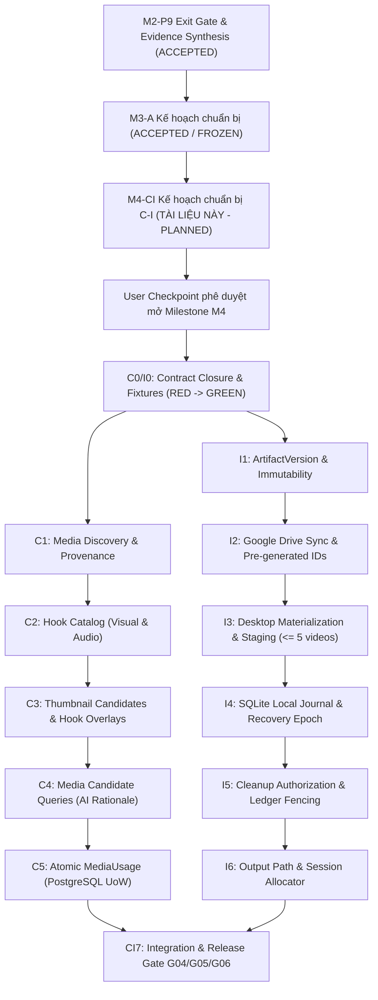

# Gói Chuẩn Bị Thực Thi Kỹ Thuật: M4-CI (Kho Media, Hook & Lưu Trữ Hybrid C-I)

> **Mã định danh gói (Package ID):** `M4-CI` (Chuyển tiếp từ `M4-CI-TEMPLATE`)
> **Milestone liên quan:** `M4` - Kho media và lưu trữ hybrid (`R2 Media Alpha`)
> **Trạng thái thẩm quyền (Authority State):** `planned` (Chuẩn bị kế hoạch thực thi kỹ thuật; cấm triển khai mã nguồn sản phẩm khi chưa có User Checkpoint phê duyệt mở Milestone M4)
> **Phân hệ sở hữu (Owners):** Phân hệ C (`media_catalog` / `CAP-C-STORAGE`) & Phân hệ I (`storage_lifecycle` / `CAP-I-STORAGE-SYNC`)
> **Thời điểm xác lập:** 09-10-2026 (Sau khi M3-A hoàn tất kế hoạch và chốt baseline)
> **Tài liệu nguồn thẩm quyền:**
> - [docs/11-roadmap.md](../11-roadmap.md) (Mục 10 - M4, Mục 16, 23)
> - [docs/12-pre-code-checklist.md](../12-pre-code-checklist.md) (PCC-020, PCC-022, PCC-024)
> - [docs/modules/capability-c-storage.md](../modules/capability-c-storage.md)
> - [docs/06-system-map.md](../06-system-map.md) (Phân hệ C, Phân hệ I)
> - [docs/08-architecture.md](../08-architecture.md) (Module `media_catalog`, `storage_lifecycle`, ARCH-008)
> - [docs/adr/0006-drive-artifacts-and-local-journal.md](../adr/0006-drive-artifacts-and-local-journal.md)
> - [docs/adr/0010-storage-lifecycle-and-recovery.md](../adr/0010-storage-lifecycle-and-recovery.md)
> - [docs/parallel-delivery/operating-model.md](./operating-model.md)
> - [docs/parallel-delivery/ownership-and-locks.yaml](./ownership-and-locks.yaml)
> - [docs/parallel-delivery/task-dag.yaml](./task-dag.yaml)
> - [docs/parallel-delivery/acceptance-matrix.yaml](./acceptance-matrix.yaml) (R21, R22, R25; Gates G04, G05, G06)

---

## 1. Mục Đích và Giới Hạn Của Gói Chuẩn Bị M4-CI

Gói chuẩn bị thực thi `M4-CI` thiết lập toàn bộ cơ sở kỹ thuật machine-readable và human-readable cho Phân hệ C (Quản lý Danh mục Media & Phân tích Hook) và Phân hệ I (Lưu trữ Byte, Artifact & Đồng bộ Google Drive) trước khi bước vào chu trình TDD (Test-Driven Development).

### 1.1. Phạm vi thực hiện
- Định nghĩa ranh giới phân tách trách nhiệm giữa Danh mục Metadata/Hook (`Module C`) và Quản lý Lưu trữ Byte Vật lý/Đồng bộ Cloud (`Module I`) theo kiến trúc hybrid.
- Khóa chặt các phiên bản hợp đồng (Contract Freeze) với SHA-256 bất biến: `CONTRACT-CONTENT-MEDIA` và `CONTRACT-STORAGE` cùng các hợp đồng dùng chung liên quan.
- Thiết lập bản đồ dependency, ma trận khóa tài nguyên (Resource Locks & Leases), chính sách rollback an toàn bảo tồn evidence M1, M2 và M3.
- Định vị chính xác các điểm kiểm tra hỏng hóc hành vi (Behavioral RED Oracles) cho từng gói công việc nhỏ C0..C5, I0..I6 và CI7.

### 1.2. Giới hạn nghiêm ngặt (Fail-Closed Boundaries)
- **Tuyệt đối không sửa đổi mã nguồn sản phẩm (Product Source):** Không tạo hoặc chỉnh sửa bất kỳ tệp nào trong `src/**`.
- **Tuyệt đối không sửa đổi database migration:** Không chạm vào `migrations/**` hoặc `src/**/migrations/**`.
- **Tuyệt đối không ghi đè evidence lịch sử:** Không chạm vào `docs/milestones/**/evidence/**` của M1 (P0..P6), M2 (P0..P9) và các gói chuẩn bị đã nghiệm thu.
- **Trạng thái thực thi:** Triển khai mã nguồn sản phẩm và migration vẫn tiếp tục bị **KHÓA CHẶT** (`NOT AUTHORIZED`) theo quy định tại `docs/12-pre-code-checklist.md` cho đến khi có User Checkpoint chính thức kích hoạt Milestone M4.

---

## 2. Tiền Đề Kỹ Thuật & Đồ Thị Phụ Thuộc (DAG Dependencies)

### 2.1. Điều kiện tiền đề kỹ thuật (Technical Preconditions)
1. **M2 và M3-A hoàn tất:** Cơ sở hạ tầng PostgreSQL Connection Pool, Transactional Outbox, Command/Query Envelopes, SQLite local journal, Windows DPAPI Secret Broker và hợp đồng chuẩn đã sẵn sàng.
2. **Hạ tầng lưu trữ Google Drive:** Mô hình 4 StorageArea độc lập tương ứng với 4 tài khoản Drive riêng biệt (tổng danh nghĩa 20 TB) đã được cấu hình qua Service Account/OAuth credentials trong DPAPI Broker của Phân hệ J (Gate G04).
3. **Môi trường máy trạm:** Thư mục staging cục bộ độc lập được Phân hệ I cấp phát, SQLite engine cục bộ và công cụ probe media (FFprobe binary) đã sẵn sàng.

---

## 3. Ranh Giới Sở Hữu Mã Nguồn (Single-Writer Ownership & Source Paths)

Tuân thủ nguyên tắc Single-Writer tại `docs/parallel-delivery/ownership-and-locks.yaml`: Phân hệ C và Phân hệ I là những người ghi duy nhất (Single-Writer) vào các aggregate và đường dẫn tương ứng khi được cấp thẩm quyền.

> **Lưu ý ranh giới sở hữu & Trạng thái đề xuất (Registered vs Proposed Paths Boundary):**
> - **Phân hệ C:** Đã có ownership entry chính thức trong `docs/parallel-delivery/ownership-and-locks.yaml` là `PATH-SRC-CATALOG` bao gồm `src/catalog/**`, `tests/unit/catalog/**` và `docs/modules/capability-c-storage.md` thuộc quyền sở hữu của `Module_C_Catalog_Owner` với khóa `LOCK-SRC-CATALOG`.
> - **Phân hệ I:** Trong sổ bộ sở hữu hiện hành (`docs/parallel-delivery/ownership-and-locks.yaml`), các đường dẫn `src/storage/**`, `tests/unit/storage/**` và `tests/integration/storage/**` là **proposed paths (đường dẫn đề xuất)**, hiện tại **chưa có ownership entry** nào được cấp trong registry.
> - Khóa `LOCK-SRC-STORAGE` bảo vệ mã nguồn của Module I là **proposed lock (khóa đề xuất)**, hiện **chưa được đăng ký** trong registry.
> - Package M4-CI **không tự sửa registry**, và **không khẳng định package đã khóa đầy đủ ranh giới sở hữu mã nguồn** của Phân hệ I.
> - Việc thiếu entry `PATH-SRC-STORAGE` và `LOCK-SRC-STORAGE` trong registry là một open decision gate: `GATE-M4-I-OWNERSHIP-LOCK`. Mọi dispatch implementation đối với Phân hệ I đều bị **BLOCKED** fail-closed cho tới khi gate này được giải quyết.

### 3.1. Aggregates thuộc quyền sở hữu của Phân hệ C
- `MediaAsset`: Bản ghi metadata định danh tài nguyên media logic kèm dấu vân tay canonical fingerprint.
- `MediaAnalysis`: Kết quả phân tích thị giác/thính giác (vùng an toàn 9:16, điểm sắc nét, độ phân giải, kiểm định an toàn hình ảnh).
- `Hook`: Thực thể đại diện cho các ứng viên hook độc lập (`VisualHook`, `AudioHook`, `ThumbnailCandidate`).
- `MediaUsage`: Sổ ghi nhận lượt sử dụng media cho từng video hoàn chỉnh để điều phối tần suất xuất hiện và tránh lặp.

### 3.2. Aggregates thuộc quyền sở hữu của Phân hệ I
- `ArtifactVersion`: Dòng byte bất biến có mã băm SHA-256 xác định, kích thước, retention class và quan hệ lineage.
- `ArtifactLocation`: Vị trí vật lý cụ thể của một version trên đĩa cục bộ hoặc Google Drive StorageArea kèm trạng thái xác thực.
- `CleanupAuthorization`: Chứng chỉ ủy quyền dọn dẹp bất biến gắn với tệp, đường dẫn, mã băm, bằng chứng cloud và recovery epoch.
- `LocalJournalEntry`: Bản ghi nhật ký cục bộ SQLite trên máy trạm theo dõi tiến trình materialize, lease và khôi phục sự cố.

### 3.3. Cấu trúc thư mục mã nguồn cụ thể (Target Specific Source Paths)

| Đường dẫn (Source Paths) | Trạng thái đăng ký | Vai trò kiến trúc & Trách nhiệm sở hữu |
|---|---|---|
| `src/catalog/__init__.py` | Đã đăng ký (`PATH-SRC-CATALOG`) | Module entry point cho Phân hệ C |
| `src/catalog/domain/models.py` | Đã đăng ký (`PATH-SRC-CATALOG`) | Thực thể MediaAsset, Hook, MediaUsage, Analysis |
| `src/catalog/domain/lifecycle.py` | Đã đăng ký (`PATH-SRC-CATALOG`) | State machines CT-STATE-005, CT-STATE-006 |
| `src/catalog/application/media_service.py` | Đã đăng ký (`PATH-SRC-CATALOG`) | Xử lý đăng ký discovery, rendition theo CT-MED-001/003 |
| `src/catalog/application/hook_service.py` | Đã đăng ký (`PATH-SRC-CATALOG`) | Quản lý nhập và cập nhật metadata hook theo CT-HOOK-001/002 |
| `src/catalog/application/candidate_query_service.py` | Đã đăng ký (`PATH-SRC-CATALOG`) | Truy vấn ứng viên cho AI kịch bản theo CT-MED-005/006 |
| `src/catalog/application/usage_service.py` | Đã đăng ký (`PATH-SRC-CATALOG`) | Ghi nhận MediaUsage nguyên tử theo CT-MED-008 |
| `src/catalog/ports/inbound.py` | Đã đăng ký (`PATH-SRC-CATALOG`) | Inbound interfaces cho Ingestion (B), AI (D), Orchestration (G) |
| `src/catalog/ports/outbound.py` | Đã đăng ký (`PATH-SRC-CATALOG`) | Outbound ports tương tác Storage (I), Processing (E) |
| `src/catalog/infrastructure/db/repositories.py` | Đã đăng ký (`PATH-SRC-CATALOG`) | PostgreSQL UoW repositories cho MediaAsset và Hooks |
| `tests/unit/catalog/**` | Đã đăng ký (`PATH-SRC-CATALOG`) | Bộ kiểm thử unit test cho Phân hệ C |
| `src/storage/__init__.py` | **Đề xuất (Proposed Path)** | Module entry point cho Phân hệ I |
| `src/storage/domain/models.py` | **Đề xuất (Proposed Path)** | Thực thể ArtifactVersion, ArtifactLocation, CleanupAuth |
| `src/storage/domain/lifecycle.py` | **Đề xuất (Proposed Path)** | State machines CT-STATE-011, CT-STATE-012 |
| `src/storage/application/artifact_service.py` | **Đề xuất (Proposed Path)** | Khai báo và quản lý version bất biến theo CT-STO-001 |
| `src/storage/application/drive_sync_service.py` | **Đề xuất (Proposed Path)** | Upload Google Drive với pre-generated IDs theo CT-STO-003 |
| `src/storage/application/materialize_service.py` | **Đề xuất (Proposed Path)** | Tải tệp về desktop, kiểm soát working set <= 5 video (CT-STO-004) |
| `src/storage/application/cleanup_service.py` | **Đề xuất (Proposed Path)** | Đánh giá và thực thi dọn dẹp an toàn theo CT-STO-007/008 |
| `src/storage/ports/inbound.py` | **Đề xuất (Proposed Path)** | Inbound interfaces cho Render (F), Media (C), Ingestion (A/B) |
| `src/storage/ports/outbound.py` | **Đề xuất (Proposed Path)** | Outbound ports kết nối Drive API, DPAPI Secret Broker (J) |
| `src/storage/adapters/google_drive_adapter.py` | **Đề xuất (Proposed Path)** | Adapter Google Drive API 4 StorageAreas (ARCH-008, ADR-0006) |
| `src/storage/adapters/sqlite_journal_adapter.py` | **Đề xuất (Proposed Path)** | Adapter SQLite local journal và crash recovery (CT-STO-005) |
| `src/storage/adapters/filesystem_staging_adapter.py` | **Đề xuất (Proposed Path)** | Quản lý staging root, kiểm tra hash, chống path traversal |
| `src/storage/infrastructure/db/repositories.py` | **Đề xuất (Proposed Path)** | PostgreSQL UoW repositories cho Artifact manifests |
| `tests/unit/storage/**` | **Đề xuất (Proposed Path)** | Bộ kiểm thử unit test cho Phân hệ I |
| `tests/integration/storage/**` | **Đề xuất (Proposed Path)** | Bộ kiểm thử tích hợp Drive sync, recovery, cleanup |

### 3.4. Ranh giới cấm ghi chéo (Strictly Forbidden Cross-Owner Paths)
- **Phân hệ C tuyệt đối không can thiệp byte:** Không gọi filesystem I/O trực tiếp để lưu trữ hoặc xóa tệp byte vật lý; mọi nhu cầu lưu byte hoặc kiểm tra toàn vẹn phải thông qua Port của Phân hệ I (`interface_c_i`).
- **Phân hệ I tuyệt đối không sửa metadata danh mục:** Không ghi trực tiếp vào các bảng `media_assets`, `hooks`, `media_usage` của C; không tự ý đánh giá nội dung hoặc sửa đổi liên kết logic.
- **Cả hai phân hệ tuyệt đối không ghi chéo:**
  - Không ghi vào bảng của B: `articles`, `article_revisions`, `events`.
  - Không ghi vào bảng của D: `story_angles`, `script_versions`, `production_plans`.
  - Không ghi vào bảng của G: `batches`, `jobs`, `stage_runs`, `completion_ledgers`.
- **Giao tiếp liên phân hệ bắt buộc qua:**
  1. `interface_c_i`: C quản lý metadata/hook; I quản lý byte/location/drive sync.
  2. `interface_g_c_i`: PostgreSQL Unit of Work nguyên tử của Orchestrator (G) hoàn tất video job, ghi nhận media usage ở C và vị trí output ở I.
  3. `interface_e_c_i`: Module E probe media và tạo rendition; bàn giao metadata cho C và artifact byte cho I.

---

## 4. Quản Lý Khóa Tài Nguyên & Fencing (Resource Locks & Leases)

Theo mô hình `ownership-and-locks.yaml` và `operating-model.md`:

| Tên Khóa (Lock ID) | Kiểu khóa (Type) | Mục đích bảo vệ | Fencing Token & Rule |
|---|---|---|---|
| `LOCK-CONTRACT-CONTENT-MEDIA` | Exclusive Contract Lock | Bảo vệ tính bất biến của hợp đồng `CT-MED-*` và `CT-HOOK-*` | Đóng băng ở SHA-256 xác định; không writer nào được sửa |
| `LOCK-CONTRACT-STORAGE` | Exclusive Contract Lock | Bảo vệ tính bất biến của hợp đồng lưu trữ `CT-STO-*` | Đóng băng ở SHA-256 xác định; không writer nào được sửa |
| `LOCK-SRC-CATALOG` | Exclusive Path Lock (Đã đăng ký) | Bảo vệ mã nguồn `src/catalog/**` và tests của Phân hệ C | Cấp cho worker implementer trong suốt ca làm việc |
| `LOCK-SRC-STORAGE` | Proposed Path Lock (Chưa đăng ký) | Khóa đề xuất bảo vệ mã nguồn `src/storage/**` của Phân hệ I | **Khóa đề xuất, hiện chưa tồn tại trong registry**. Bắt buộc phải có gate đăng ký chính thức vào `ownership-and-locks.yaml` trước dispatch implementation; chưa đăng ký thì dispatch bị BLOCKED fail-closed |
| `LOCK-EXTERNAL-DRIVE` | Exclusive by Account/Namespace | Bảo vệ tài khoản Google Drive probe và upload sandbox | Phân vùng theo partition `drive:<account_id>:<namespace>`; lease 600s |
| `LOCK-POSTGRES-TEST-DB` | Exclusive by DB Namespace | Cách ly database thử nghiệm (ví dụ `db:m4_media_storage_test`) | Disposable database function/run-scoped; dọn dẹp sạch sau test |
| `LOCK-MIGRATION-SEQUENCE` | Serialized Migration Lock | Khi tạo migration cho các bảng của Module C và Module I | Single-writer tuần tự qua merge queue; cấm tạo song song |

> **Quy tắc khóa tài nguyên & Fencing (Lock Invariants):**
> - `LOCK-SRC-STORAGE` là **proposed lock chưa được đăng ký** trong `docs/parallel-delivery/ownership-and-locks.yaml`.
> - Tuyệt đối **không tự ý sửa registry**, **không dùng khóa của module khác thay thế** và **không khẳng định package đã khóa đầy đủ**.
> - Việc thiếu entry `LOCK-SRC-STORAGE` trong registry là một open decision gate: Mọi dispatch implementation đối với Phân hệ I đều bị **BLOCKED** fail-closed cho tới khi gate này được giải quyết.

---

## 5. Chiến Lược Rollback & Bảo Toàn Dữ Liệu (Rollback Strategy)

1. **Rollback ở mức mã nguồn:**
   - Git revert nguyên tử commit ứng viên.
   - Worktree biệt lập ngăn ngừa ô nhiễm nhánh chính.
2. **Rollback ở mức cơ sở dữ liệu:**
   - Mỗi migration script của Phân hệ C và I bắt buộc có phương thức `down()` tương ứng hoàn chỉnh.
   - Kiểm thử rollback migration tự động trong sandbox trước khi đưa vào merge queue.
3. **Bảo toàn Evidence bất biến (Preserves Accepted Evidence):**
   - Không được chạm vào hoặc làm thay đổi hash của:
     - `docs/milestones/m1-proof/evidence/**`
     - `docs/milestones/m2-control-plane/evidence/**`
     - Các evidence đã nghiệm thu của M3.
   - Bất kỳ vi phạm nào đối với evidence đã được nghiệm thu sẽ kích hoạt trạng thái `FAIL` fail-closed ngay lập tức.

---

## 6. Danh Mục Open Items & Hạn Quyết Định (Open Decision Gates)

Trước khi kích hoạt sản xuất (`production_activation_authorized`), các điểm kỹ thuật sau phải được chốt qua Config Revision từ Module J hoặc quyết định chính thức:

| Mã Open Item | Nội dung kỹ thuật | Phạm vi ảnh hưởng | Hạn chốt bắt buộc |
|---|---|---|---|
| `ROADMAP-OPEN-010` | Chính sách retention và storage placement cho 4 tài khoản Drive | Phân bổ quota và lưu trữ theo CT-STO-010 | Trước khi kích hoạt unattended cleanup |
| `QUALITY-OPEN-004` | Cơ chế checksum và integrity verification cụ thể trên Google Drive | Xác thực mã băm tệp trên cloud theo Gate G04 | Trước khi nghiệm thu Gate G04 trên tài khoản thật |
| `QUALITY-OPEN-006` | Ngưỡng working set và disk buffer cho desktop materialization | Giới hạn dung lượng staging cục bộ (5 video limit) | Trước khi nghiệm thu gate hiệu năng render |
| `POLICY-CAT-001` | Trọng số thành phần tính điểm lựa chọn media candidate | `QueryMediaCandidates` (CT-MED-005) | Cung cấp qua `ConfigRevision` từ J; không hardcode |
| `GATE-M4-I-OWNERSHIP-LOCK` | Control / Authority Owner phê duyệt và đăng ký `PATH-SRC-STORAGE` (`src/storage/**`, `tests/unit/storage/**`, `tests/integration/storage/**`) cùng `LOCK-SRC-STORAGE` vào `docs/parallel-delivery/ownership-and-locks.yaml` | Toàn bộ quá trình cấp quyền và dispatch implementation Phân hệ I | Trước khi dispatch M4 implementation. Chưa có gate phê duyệt và đăng ký thì implementation bị **BLOCKED** fail-closed |
| `USER-CKPT-M4` | Checkpoint phê duyệt chính thức mở Milestone M4 từ Người dùng | Chuyển trạng thái từ `planned` sang `implementation_authorized` | Điều kiện tiên quyết tuyệt đối trước dòng code đầu tiên của M4 |

---

## 7. Kết Luận & Định Hướng Tiếp Theo

Gói chuẩn bị `M4-CI` đã hoàn tất việc thiết lập cơ sở kế hoạch kỹ thuật (`planned`), ánh xạ đầy đủ tài liệu thẩm quyền hiện hành, đóng băng phiên bản các hợp đồng giao tiếp (`CONTRACT-CONTENT-MEDIA`, `CONTRACT-STORAGE`) và thiết lập lộ trình kiểm thử test-first nghiêm ngặt.

Tuy nhiên, gói này **không khẳng định đã khóa đầy đủ ranh giới**: trong khi Phân hệ C đã có `PATH-SRC-CATALOG` và `LOCK-SRC-CATALOG` đăng ký chính thức, thì các đường dẫn mã nguồn của Phân hệ I (`src/storage/**`, `tests/unit/storage/**`, `tests/integration/storage/**`) và khóa `LOCK-SRC-STORAGE` mới chỉ ở trạng thái đề xuất (**proposed paths & proposed lock**), hiện **chưa có ownership entry** và **chưa được đăng ký** trong sổ bộ `docs/parallel-delivery/ownership-and-locks.yaml`. Phân hệ I tuyệt đối không tự sửa registry và không mượn khóa của module khác để thay thế.

Do đó, toàn bộ hoạt động dispatch implementation của Milestone M4 tiếp tục bị **BLOCKED** fail-closed cho đến khi đáp ứng đồng thời hai điều kiện tiên quyết:
1. Gate `GATE-M4-I-OWNERSHIP-LOCK` được Control / Authority Owner phê duyệt và đăng ký chính thức vào `ownership-and-locks.yaml`.
2. Checkpoint `USER-CKPT-M4` được Người dùng phê duyệt chính thức mở Milestone M4.

Hồ sơ kế hoạch sẵn sàng cho bước thẩm tra kỹ thuật read-only từ Sol-Lead và Astra-Lead.
