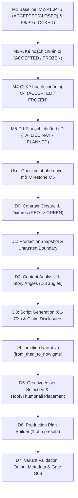

# Gói Chuẩn Bị Thực Thi Kỹ Thuật: M5-D (Phân Hệ D - Sáng Tạo Kịch Bản & Kế Hoạch Sản Xuất)

> **Mã định danh gói (Package ID):** `M5-D` (Chuyển tiếp từ `M5-D-TEMPLATE`)
> **Milestone liên quan:** `M5` - Bộ não nội dung AI (`R3 Creative Alpha`)
> **Trạng thái thẩm quyền (Authority State):** `planned` (Chuẩn bị kế hoạch thực thi kỹ thuật; cấm triển khai mã nguồn sản phẩm khi chưa có User Checkpoint phê duyệt mở Milestone M5)
> **Phân hệ sở hữu (Owner):** Phân hệ D (`creative_scripting` / `CAP-D-SCRIPTING`)
> **Thời điểm xác lập:** 09-10-2026 (Sau khi M4-CI hoàn tất kế hoạch và chốt baseline)
> **Tài liệu nguồn thẩm quyền:**
> - [docs/11-roadmap.md](../11-roadmap.md) (Mục 11 - M5, Mục 16, 23)
> - [docs/12-pre-code-checklist.md](../12-pre-code-checklist.md) (PCC-020, PCC-022, PCC-024)
> - [docs/modules/capability-d-scripting.md](../modules/capability-d-scripting.md)
> - [docs/06-system-map.md](../06-system-map.md) (Phân hệ D)
> - [docs/08-architecture.md](../08-architecture.md) (Module `creative_scripting`, ARCH-008, ARCH-009)
> - [docs/adr/0008-ai-routing-and-quota.md](../adr/0008-ai-routing-and-quota.md)
> - [docs/adr/0005-snapshots-and-content-invariants.md](../adr/0005-snapshots-and-content-invariants.md)
> - [docs/parallel-delivery/operating-model.md](./operating-model.md)
> - [docs/parallel-delivery/ownership-and-locks.yaml](./ownership-and-locks.yaml)
> - [docs/parallel-delivery/task-dag.yaml](./task-dag.yaml)
> - [docs/parallel-delivery/acceptance-matrix.yaml](./acceptance-matrix.yaml) (R05..R08, Gate G06)

---

## 1. Mục Đích và Giới Hạn Của Gói Chuẩn Bị M5-D

Gói chuẩn bị thực thi `M5-D` thiết lập toàn bộ cơ sở kỹ thuật machine-readable và human-readable cho Phân hệ D (Bộ não nội dung AI & Sáng tạo kịch bản) trước khi bước vào chu trình TDD (Test-Driven Development).

### 1.1. Phạm vi thực hiện
- Định nghĩa ranh giới kiến trúc và trách nhiệm của Phân hệ D trong chuỗi giá trị nội dung: Từ bản chụp bài viết bất biến (`ProductionSnapshot`), phân tích thực thể (`ContentAnalysis`), sinh góc kể đa dạng (`StoryAngle`), soạn thảo kịch bản phân cảnh 61–70 giây (`ScriptVersion`), gán ghép hook và media (`AssetSelection`), lập kế hoạch dựng chi tiết (`ProductionPlan`) cho đến thẩm định dấu vân tay biến thể (`VariantFingerprint`).
- Khóa chặt các phiên bản hợp đồng (Contract Freeze) với SHA-256 bất biến: `CONTRACT-CREATIVE-AI` và các hợp đồng dùng chung liên quan.
- Thiết lập bản đồ dependency, ma trận khóa tài nguyên (Resource Locks & Leases), chính sách rollback an toàn bảo tồn evidence M1, M2, M3 và M4.
- Định vị chính xác các điểm kiểm tra hỏng hóc hành vi (Behavioral RED Oracles) cho từng gói công việc nhỏ D0..D7.

### 1.2. Giới hạn nghiêm ngặt (Fail-Closed Boundaries)
- **Tuyệt đối không sửa đổi mã nguồn sản phẩm (Product Source):** Không tạo hoặc chỉnh sửa bất kỳ tệp nào trong `src/**`.
- **Tuyệt đối không sửa đổi database migration:** Không chạm vào `migrations/**` hoặc `src/**/migrations/**`.
- **Tuyệt đối không ghi đè evidence lịch sử:** Không chạm vào `docs/milestones/**/evidence/**` của M1 (P0..P6), M2 (P0..P9) và các gói chuẩn bị đã nghiệm thu.
- **Trạng thái thực thi:** Triển khai mã nguồn sản phẩm và migration vẫn tiếp tục bị **KHÓA CHẶT** (`NOT AUTHORIZED`) theo quy định tại `docs/12-pre-code-checklist.md` cho đến khi có User Checkpoint chính thức kích hoạt Milestone M5.

---

## 2. Tiền Đề Kỹ Thuật & Đồ Thị Phụ Thuộc (DAG Dependencies)

### 2.1. Điều kiện tiền đề kỹ thuật (Technical Preconditions)
1. **Cơ sở hạ tầng M2-P1..P7B cùng kế hoạch M3-A và M4-CI:** Cơ sở hạ tầng PostgreSQL Connection Pool, Transactional Outbox, Command/Query Envelopes, SQLite local journal, Windows DPAPI Secret Broker và hợp đồng chuẩn đã sẵn sàng từ phạm vi M2-P1..P7B (ACCEPTED/CLOSED). Lưu ý theo authority hiện hành, M2-P8 và M2-P9 tiếp tục duy trì trạng thái LOCKED (chưa có quyền RED/implementation, M2 chưa hoàn tất toàn bộ); các gói chuẩn bị M3-A và M4-CI là kế hoạch đã đóng băng (ACCEPTED / FROZEN).
2. **Hạ tầng AI Adapter & Secret Broker (Module J):** Cổng gọi mô hình AI thông qua `CT-AI-ROUTE-001` sẵn sàng cung cấp provider handle ngắn hạn, cô lập hoàn toàn API keys khỏi Module D (Gate G03/G04).
3. **Kho tài nguyên Media & Hook (Module C):** Danh mục `MediaAsset`, `VisualHook`, `AudioHook` và `ThumbnailCandidate` sẵn sàng phục vụ truy vấn ứng viên theo `CT-MED-005` và `CT-MED-006`.
4. **Sổ bộ 5 Preset (Five-Preset Registry):** Định nghĩa 5 nhóm preset phong cách video chuẩn đã được khóa revision, sẵn sàng cho việc gán ghép trong `ProductionPlan`.

---

## 3. Ranh Giới Sở Hữu Mã Nguồn (Single-Writer Ownership & Source Paths)

Tuân thủ nguyên tắc Single-Writer tại `docs/parallel-delivery/ownership-and-locks.yaml`: Phân hệ D là người ghi duy nhất (Single-Writer) vào các aggregate và đường dẫn tương ứng khi được cấp thẩm quyền.

> **Lưu ý ranh giới sở hữu & Trạng thái đề xuất (Registered vs Proposed Paths Boundary):**
> - **Mã nguồn và Unit Test Phân hệ D:** Đã có ownership entry chính thức trong `docs/parallel-delivery/ownership-and-locks.yaml` là `PATH-SRC-CREATIVE` bao gồm `src/creative/**`, `tests/unit/creative/**` và `docs/modules/capability-d-scripting.md` thuộc quyền sở hữu của `Module_D_Scripting_Owner` với khóa `LOCK-SRC-CREATIVE`.
> - **Đường dẫn kiểm thử tích hợp (Integration Tests):** Trong sổ bộ sở hữu hiện hành (`docs/parallel-delivery/ownership-and-locks.yaml`), đường dẫn `tests/integration/creative/**` là **proposed path (đường dẫn đề xuất)**, hiện tại **chưa có pattern cụ thể** trong entry `PATH-SRC-CREATIVE`.
> - Package M5-D **không tự sửa registry**, và **không khẳng định package đã khóa đầy đủ ranh giới sở hữu** cho toàn bộ các tệp kiểm thử tích hợp.
> - Việc bổ sung pattern `tests/integration/creative/**` vào registry là một open decision gate: `GATE-M5-D-INTEGRATION-PATH`. Mọi dispatch implementation liên quan đến integration tests của Phân hệ D đều bị **BLOCKED** fail-closed cho tới khi gate này được giải quyết.

### 3.1. Aggregates thuộc quyền sở hữu của Phân hệ D
- `ProductionSnapshot`: Bản chụp đầu vào bất biến chứa exact article/event refs, source revisions, media/hook index revisions, prompt/config revisions, fingerprint và timestamp.
- `StoryAngle`: Góc tiếp cận câu chuyện độc lập (ví dụ: điều tra, chuyên gia, nhân chứng, dòng thời gian) kèm narrative question, focus entities và distinction fingerprint.
- `ScriptVersion`: Văn bản kịch bản phân cảnh 61–70 giây bằng tiếng Anh, chứa các phân đoạn narration, chỉ dẫn phát âm, phân loại claim (`source_backed`, `inference`, `creative_hypothesis`, `transition`) và công bố suy luận rõ ràng.
- `ProductionPlan`: Kế hoạch sản xuất chi tiết kết nối kịch bản, preset (1 trong 5 nhóm), phân bổ visual hook, audio hook, thumbnail marker, timeline, asset sequence và chỉ dẫn âm thanh/hình ảnh.
- `VariantFingerprint`: Dấu vân tay cấu trúc kịch bản và kế hoạch sản xuất, dùng để đối chiếu loại trừ trùng lặp giữa các lần xuất bản.

### 3.2. Cấu trúc thư mục mã nguồn cụ thể (Target Specific Source Paths)

| Đường dẫn (Source Paths) | Trạng thái đăng ký | Vai trò kiến trúc & Trách nhiệm sở hữu |
|---|---|---|
| `src/creative/__init__.py` | Đã đăng ký (`PATH-SRC-CREATIVE`) | Module entry point cho Phân hệ D |
| `src/creative/domain/models.py` | Đã đăng ký (`PATH-SRC-CREATIVE`) | Thực thể ProductionSnapshot, StoryAngle, ScriptVersion, ProductionPlan, VariantFingerprint |
| `src/creative/domain/lifecycle.py` | Đã đăng ký (`PATH-SRC-CREATIVE`) | State machines CT-STATE-007, CT-STATE-004 |
| `src/creative/application/snapshot_service.py` | Đã đăng ký (`PATH-SRC-CREATIVE`) | Xây dựng và khóa ProductionSnapshot theo CT-AI-001 |
| `src/creative/application/content_analysis_service.py` | Đã đăng ký (`PATH-SRC-CREATIVE`) | Phân tích bài viết, entities, timeline, claims theo CT-AI-002 |
| `src/creative/application/story_angle_service.py` | Đã đăng ký (`PATH-SRC-CREATIVE`) | Sinh 1-3 góc kể đa dạng theo CT-AI-003, INV-013 |
| `src/creative/application/script_service.py` | Đã đăng ký (`PATH-SRC-CREATIVE`) | Soạn thảo kịch bản 61-70s, phân loại claim theo CT-AI-004, INV-014 |
| `src/creative/application/timeline_narrative_service.py` | Đã đăng ký (`PATH-SRC-CREATIVE`) | Ủy quyền kể chuyện dòng thời gian from_then_to_now theo CT-AI-005 |
| `src/creative/application/asset_selection_service.py` | Đã đăng ký (`PATH-SRC-CREATIVE`) | Chọn hook, thumbnail (0-3s), media theo CT-AI-006, INV-020 |
| `src/creative/application/production_plan_service.py` | Đã đăng ký (`PATH-SRC-CREATIVE`) | Lập kế hoạch dựng phân cảnh 5-preset theo CT-AI-007 |
| `src/creative/application/variant_validation_service.py` | Đã đăng ký (`PATH-SRC-CREATIVE`) | Kiểm tra biến thể, chống trùng lặp theo CT-AI-008, INV-004 |
| `src/creative/application/output_metadata_service.py` | Đã đăng ký (`PATH-SRC-CREATIVE`) | Sinh SEO title/caption, 3-4 hashtags, filename an toàn theo CT-AI-009 |
| `src/creative/ports/inbound.py` | Đã đăng ký (`PATH-SRC-CREATIVE`) | Inbound interfaces cho Ingestion (B), Orchestration (G) |
| `src/creative/ports/outbound.py` | Đã đăng ký (`PATH-SRC-CREATIVE`) | Outbound ports tương tác AI Provider (J), Catalog (C), TTS (E), Render (F) |
| `src/creative/adapters/ai_adapter_client.py` | Đã đăng ký (`PATH-SRC-CREATIVE`) | Client adapter gọi AI qua Secret Broker của J (CT-AI-010, CT-AI-ROUTE-001) |
| `src/creative/infrastructure/db/repositories.py` | Đã đăng ký (`PATH-SRC-CREATIVE`) | PostgreSQL UoW repositories cho creative entities |
| `tests/unit/creative/**` | Đã đăng ký (`PATH-SRC-CREATIVE`) | Bộ kiểm thử unit test cho Phân hệ D |
| `tests/integration/creative/**` | **Đề xuất (Proposed Path)** | Bộ kiểm thử tích hợp AI pipeline, variant deduplication, Gate G06 |

### 3.3. Ranh giới cấm ghi chéo (Strictly Forbidden Cross-Owner Paths)
- **Phân hệ D tuyệt đối không can thiệp byte lưu trữ:** Không gọi filesystem I/O trực tiếp để lưu hoặc xóa media byte vật lý; mọi nhu cầu về tệp phải thông qua Port của Phân hệ I (`CONTRACT-STORAGE`).
- **Phân hệ D tuyệt đối không nắm giữ secret:** Không lưu trữ API key hoặc token dạng plain-text; mọi lời gọi mô hình phải qua adapter của Phân hệ J (`CONTRACT-CONFIG-SECURITY`).
- **Phân hệ D tuyệt đối không ghi chéo vào bảng của phân hệ khác:**
  - Không ghi vào bảng của B: `articles`, `article_revisions`, `events`, `event_updates`.
  - Không ghi vào bảng của C: `media_assets`, `hooks`, `media_usage`.
  - Không ghi vào bảng của G: `batches`, `jobs`, `stage_runs`, `completion_ledgers`.
  - Không ghi vào bảng của I: `artifacts`, `artifact_versions`, `artifact_locations`.
- **Giao tiếp liên phân hệ bắt buộc qua:**
  1. `interface_b_d`: B bàn giao `ArticleSnapshot` sạch đã chuẩn hóa theo `CT-CNT-002`.
  2. `interface_d_j`: D gọi mô hình AI qua secret handle trừu tượng theo `CT-AI-ROUTE-001`.
  3. `interface_c_d`: D truy vấn ứng viên hook/media từ C theo `CT-MED-005` và `CT-HOOK-001`.
  4. `interface_d_e_f`: D bàn giao kịch bản cho E (`CT-TTS-001`) và kế hoạch dựng cho F (`CT-RND-001`).
  5. `interface_g_d`: G điều phối workflow và quản lý `VariantReservation` theo `CT-ORC-012`.

---

## 4. Quản Lý Khóa Tài Nguyên & Fencing (Resource Locks & Leases)

Theo mô hình `ownership-and-locks.yaml` và `operating-model.md`:

| Tên Khóa (Lock ID) | Kiểu khóa (Type) | Mục đích bảo vệ | Fencing Token & Rule |
|---|---|---|---|
| `LOCK-CONTRACT-CREATIVE-AI` | Exclusive Contract Lock | Bảo vệ tính bất biến của hợp đồng sáng tạo `CT-AI-*` | Đóng băng ở SHA-256 xác định; không writer nào được sửa |
| `LOCK-SRC-CREATIVE` | Exclusive Path Lock (Đã đăng ký) | Bảo vệ mã nguồn `src/creative/**` và tests của Phân hệ D | Cấp cho worker implementer trong suốt ca làm việc |
| `LOCK-POSTGRES-TEST-DB` | Exclusive by DB Namespace | Cách ly database thử nghiệm (ví dụ `db:m5_creative_test`) | Disposable database function/run-scoped; dọn dẹp sạch sau test |
| `LOCK-MIGRATION-SEQUENCE` | Serialized Migration Lock | Khi tạo migration cho các bảng của Module D | Single-writer tuần tự qua merge queue; cấm tạo song song |
| `LOCK-AI-PROVIDER-ROUTE` | Shared Resource Lock | Sử dụng kênh định tuyến và quota sandbox của Module J | Phân bổ quota token/phút theo chính sách J; không vượt ngưỡng |

> **Quy tắc khóa tài nguyên & Fencing (Lock Invariants):**
> - Đường dẫn `tests/integration/creative/**` là **proposed path chưa được đăng ký** trong `docs/parallel-delivery/ownership-and-locks.yaml`.
> - Tuyệt đối **không tự ý sửa registry**, **không dùng khóa của module khác thay thế** và **không khẳng định package đã khóa đầy đủ**.
> - Việc thiếu entry `tests/integration/creative/**` trong registry là một open decision gate: `GATE-M5-D-INTEGRATION-PATH`. Mọi dispatch implementation đối với integration tests của Phân hệ D đều bị **BLOCKED** fail-closed cho tới khi gate này được giải quyết.

---

## 5. Chiến Lược Rollback & Bảo Toàn Dữ Liệu (Rollback Strategy)

1. **Rollback ở mức mã nguồn:**
   - Git revert nguyên tử commit ứng viên.
   - Worktree biệt lập ngăn ngừa ô nhiễm nhánh chính.
2. **Rollback ở mức cơ sở dữ liệu:**
   - Mỗi migration script của Phân hệ D bắt buộc có phương thức `down()` tương ứng hoàn chỉnh.
   - Kiểm thử rollback migration tự động trong sandbox trước khi đưa vào merge queue.
3. **Bảo toàn Evidence bất biến (Preserves Accepted Evidence):**
   - Không được chạm vào hoặc làm thay đổi hash của:
     - `docs/milestones/m1-proof/evidence/**`
     - `docs/milestones/m2-control-plane/evidence/**`
     - Các evidence đã nghiệm thu của M3 và M4.
   - Bất kỳ vi phạm nào đối với evidence đã được nghiệm thu sẽ kích hoạt trạng thái `FAIL` fail-closed ngay lập tức.

---

## 6. Danh Mục Open Items & Hạn Quyết Định (Open Decision Gates)

Trước khi kích hoạt sản xuất (`production_activation_authorized`), các điểm kỹ thuật sau phải được chốt qua Config Revision từ Module J hoặc quyết định chính thức:

| Mã Open Item | Nội dung kỹ thuật | Phạm vi ảnh hưởng | Hạn chốt bắt buộc |
|---|---|---|---|
| `ROADMAP-OPEN-005` | Cơ chế proxy cho trending / hot content discovery | Trích xuất sự kiện nóng làm đầu vào cho D | Trước khi nghiệm thu content selection |
| `ROADMAP-OPEN-006` / `TEST-OPEN-001` | Sampling plan và cỡ mẫu kiểm định chất lượng AI đạt 90%/95% | Thẩm định Gate G06 phần content | Trước khi khóa holdout test set của M5 |
| `POLICY-SCR-001` | Cấu hình system prompts, temperature và seed cho 5 preset kịch bản | Sinh kịch bản và góc kể theo CT-AI-003/004 | Cung cấp qua `ConfigRevision` từ J; không hardcode |
| `GATE-M5-D-INTEGRATION-PATH` | Control / Authority Owner phê duyệt và đăng ký pattern `tests/integration/creative/**` vào `PATH-SRC-CREATIVE` trong `docs/parallel-delivery/ownership-and-locks.yaml` | Toàn bộ quá trình cấp quyền và dispatch integration test Phân hệ D | Trước khi dispatch M5 integration testing. Chưa có gate phê duyệt thì dispatch bị **BLOCKED** fail-closed |
| `USER-CKPT-M5` | Checkpoint phê duyệt chính thức mở Milestone M5 từ Người dùng | Chuyển trạng thái từ `planned` sang `implementation_authorized` | Điều kiện tiên quyết tuyệt đối trước dòng code đầu tiên của M5 |

---

## 7. Kết Luận & Định Hướng Tiếp Theo

Gói chuẩn bị `M5-D` đã hoàn tất việc thiết lập cơ sở kế hoạch kỹ thuật (`planned`), ánh xạ đầy đủ tài liệu thẩm quyền hiện hành, đóng băng phiên bản các hợp đồng giao tiếp (`CONTRACT-CREATIVE-AI`) và thiết lập lộ trình kiểm thử test-first nghiêm ngặt.

Tuy nhiên, gói này **không khẳng định đã khóa đầy đủ ranh giới**: trong khi `PATH-SRC-CREATIVE` và `LOCK-SRC-CREATIVE` đã đăng ký chính thức cho mã nguồn và unit test (`src/creative/**`, `tests/unit/creative/**`), thì đường dẫn kiểm thử tích hợp (`tests/integration/creative/**`) mới chỉ ở trạng thái đề xuất (**proposed path**), hiện **chưa có pattern trong ownership entry** của sổ bộ `docs/parallel-delivery/ownership-and-locks.yaml`. Phân hệ D tuyệt đối không tự sửa registry và không mượn khóa của module khác để thay thế.

Do đó, toàn bộ hoạt động dispatch implementation của Milestone M5 tiếp tục bị **BLOCKED** fail-closed cho đến khi đáp ứng đồng thời hai điều kiện tiên quyết:
1. Gate `GATE-M5-D-INTEGRATION-PATH` được Control / Authority Owner phê duyệt và cập nhật chính thức vào `ownership-and-locks.yaml`.
2. Checkpoint `USER-CKPT-M5` được Người dùng phê duyệt chính thức mở Milestone M5.

Hồ sơ kế hoạch sẵn sàng cho bước thẩm tra kỹ thuật read-only từ Sol-Lead và Astra-Lead.
