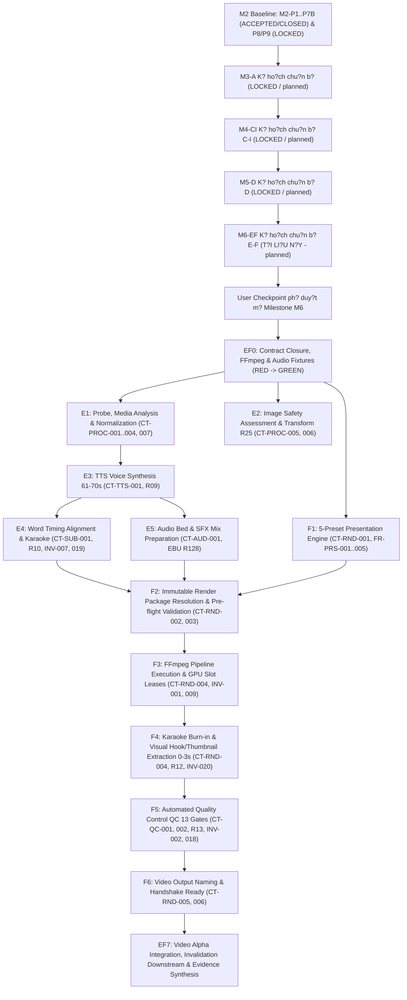

# G?i Chu?n B? Th?c Thi K? Thu?t: M6-EF (Ph?n H? E & F - X? L? ?m Thanh, D?ng Video & Ki?m ??nh Ch?t L??ng)

> **M? ??nh danh g?i (Package ID):** `M6-EF` (Chuy?n ti?p t? `M6-EF-TEMPLATE`)
> **Milestone li?n quan:** `M6` - Media production, render v? video alpha (`R4 Video Alpha`)
> **Tr?ng th?i th?m quy?n (Authority State):** `planned` (Chu?n b? k? ho?ch th?c thi k? thu?t; c?m tri?n khai m? ngu?n s?n ph?m khi ch?a c? User Checkpoint ph? duy?t m? Milestone M6)
> **Ph?n h? s? h?u (Owners):** Ph?n h? E (`media_processing_voice` / `CAP-E-VOICE`) v? Ph?n h? F (`video_rendering_qc` / `CAP-F-RENDERING`)
> **Th?i ?i?m x?c l?p:** 09-10-2026 (Sau khi M5-D ho?n t?t k? ho?ch v? ch?t baseline)
> **T?i li?u ngu?n th?m quy?n:**
> - [docs/11-roadmap.md](../11-roadmap.md) (M?c 12 - M6, M?c 16, 23)
> - [docs/12-pre-code-checklist.md](../12-pre-code-checklist.md) (PCC-020, PCC-022, PCC-024)
> - [docs/modules/capability-e-voice.md](../modules/capability-e-voice.md)
> - [docs/modules/capability-f-rendering.md](../modules/capability-f-rendering.md)
> - [docs/06-system-map.md](../06-system-map.md) (Ph?n h? E, Ph?n h? F)
> - [docs/08-architecture.md](../08-architecture.md) (Module `media_processing_voice`, `video_rendering_qc`, ARCH-008, ARCH-009)
> - [docs/adr/0007-runtime-and-admin-ui.md](../adr/0007-runtime-and-admin-ui.md)
> - [docs/adr/0011-observability-capacity-and-cost.md](../adr/0011-observability-capacity-and-cost.md)
> - [docs/parallel-delivery/operating-model.md](./operating-model.md)
> - [docs/parallel-delivery/ownership-and-locks.yaml](./ownership-and-locks.yaml)
> - [docs/parallel-delivery/task-dag.yaml](./task-dag.yaml)
> - [docs/parallel-delivery/acceptance-matrix.yaml](./acceptance-matrix.yaml) (R09..R13, Gates G02, G06, G07)

---

## 1. M?c ??ch v? Gi?i H?n C?a G?i Chu?n B? M6-EF

G?i chu?n b? th?c thi `M6-EF` thi?t l?p to?n b? c? s? k? thu?t machine-readable v? human-readable cho Ph?n h? E (X? l? Media, ?m thanh & Kh?p Ph? ??) v? Ph?n h? F (D?ng Video & Ki?m tra Ch?t l??ng) tr??c khi b??c v?o chu tr?nh TDD (Test-Driven Development).

### 1.1. Ph?m vi th?c hi?n
- **Ph?n h? E (`CAP-E-VOICE`):**
  - Th?c thi probe t?p ?a ph??ng ti?n, ph?n t?ch k? thu?t v? b?c t?ch metadata th?c t? (`CT-PROC-003`, `CT-PROC-004`).
  - ??nh gi? an to?n h?nh ?nh v? chuy?n ??i nh?y c?m theo ch?nh s?ch R25 (l?m m? tr? em, m?u me, v? kh?; ch? ?p d?ng cho ?nh ngu?n v? thumbnail; kh?ng ?p d?ng x? l? nh?y c?m cho video clip) (`CT-PROC-005`, `CT-PROC-006`).
  - Chu?n h?a media (crop, resize 9:16 d?c, pad, transcode, normalize audio) b?o to?n t?p g?c v? truy v?t lineage (`CT-PROC-007`).
  - T?ng h?p gi?ng ??c ti?ng Anh (TTS) g?n exact script fingerprint, th?i l??ng nghi?m ng?t 61?70 gi?y (`CT-TTS-001`, `R09`, Gate G06).
  - C?n ch?nh m?c th?i gian t?ng t? (`WordTiming`) t?ng ??n ?i?u, ?? ph? k?ch b?n 100%, ph?c v? ch?y ch? karaoke (`CT-SUB-001`, `R10`, `INV-007`, `INV-019`).
  - Chu?n b? ?m thanh n?n, nh?c & SFX, ki?m so?t ?? l?n chu?n EBU R128 (-14 ??n -16 LUFS) (`CT-AUD-001`, `FR-AUD-006`).
- **Ph?n h? F (`CAP-F-RENDERING`):**
  - Thi?t k? v? qu?n l? 5 preset phong c?ch d?ng video ?? version h?a (`CT-RND-001`, `FR-PRS-001..005`).
  - ??ng g?i v? th?m ??nh `RenderPackage` b?t bi?n tr??c khi render n?ng (`CT-RND-002`, `CT-RND-003`, `INV-011`, `INV-020`).
  - Th?c thi quy tr?nh render video MP4 1080x1920 (9:16 d?c), 30fps qua FFmpeg c? c?p ph?p slot GPU (`CT-RND-004`, `LOCK-DESKTOP-GPU`, `R11`, `INV-001`).
  - Burn-in ph? ?? ti?ng Anh v? hi?u ?ng karaoke ??i m?u theo t?ng t? (`CT-RND-004`, `R12`, `FR-REN-008`).
  - Tr?ch xu?t thumbnail JPEG ch?t l??ng cao t? khung h?nh trong 0?3 gi?y ??u c?a video (`CT-RND-004`, `INV-020`, `R08`).
  - Ki?m ??nh ch?t l??ng t? ??ng (`QualityReport`) v?i 13 c?ng ch?t l??ng (Hard gates: ph?t ???c, 61?70s, ?? hook, thumbnail 0?3s, subtitle burn-in, karaoke h?p l?, ti?ng Anh c? b?ng ch?ng) (`CT-QC-001`, `CT-QC-002`, `R13`, `INV-002`, `INV-018`, Gate G02, G07).
  - Thu d?n nguy?n t? to?n b? t?p t?m sau khi render v? gi?i ph?ng slot GPU (`INV-009`).
  - ??t t?n t?p theo chu?n an to?n Windows v? ph?i h?p b?n giao `RenderOutputReady` cho Orchestration v? Storage (`CT-RND-005`, `CT-RND-006`).

### 1.2. Gi?i h?n nghi?m ng?t (Fail-Closed Boundaries)
- **Tuy?t ??i kh?ng s?a ??i m? ngu?n s?n ph?m (Product Source):** Kh?ng t?o ho?c ch?nh s?a b?t k? t?p n?o trong `src/**`.
- **Tuy?t ??i kh?ng s?a ??i database migration:** Kh?ng ch?m v?o `migrations/**` ho?c `src/**/migrations/**`.
- **Tuy?t ??i kh?ng ghi ?? evidence l?ch s?:** Kh?ng ch?m v?o `docs/milestones/**/evidence/**` c?a M1 (P0..P6), M2 (P0..P9) v? c?c g?i chu?n b? ?? nghi?m thu.
- **Tr?ng th?i th?c thi:** Tri?n khai m? ngu?n s?n ph?m v? migration v?n ti?p t?c b? **KH?A CH?T** (`NOT AUTHORIZED`) theo quy ??nh t?i `docs/12-pre-code-checklist.md` cho ??n khi c? User Checkpoint ch?nh th?c k?ch ho?t Milestone M6.

---

## 2. Ti?n ?? K? Thu?t & ?? Th? Ph? Thu?c (DAG Dependencies)

### 2.1. ?i?u ki?n ti?n ?? k? thu?t (Technical Preconditions)
1. **C? s? h? t?ng M2-P1..P7B c?ng ranh gi?i authority M3-A, M4-CI v? M5-D:** C? s? h? t?ng PostgreSQL Connection Pool, Transactional Outbox, Command/Query Envelopes, SQLite local journal, Windows DPAPI Secret Broker v? h?p ??ng chu?n ?? s?n s?ng t? ph?m vi M2-P1..P7B (ACCEPTED/CLOSED). L?u ? theo authority hi?n h?nh t?i `docs/12-pre-code-checklist.md`: M2-P8 v? M2-P9 ti?p t?c duy tr? tr?ng th?i LOCKED (ch?a c? quy?n RED/implementation, M2 ch?a ho?n t?t to?n b?); Milestone M3 / Ph?n h? A ti?p t?c b? kh?a ch?t (NOT AUTHORIZED / LOCKED); Milestone M4 (G?i chu?n b? C-I) v? Milestone M5 (G?i chu?n b? D) m?i ? m?c k? ho?ch (planned / LOCKED). C? M3-A, M4-CI v? M5-D ch?a ???c coi l? ACCEPTED hay FROZEN runtime, v? tuy?t ??i kh?ng ???c t? c?p authority m?i; to?n b? m? ngu?n s?n ph?m v? migration c?a c?c ph?n h? n?y v?n ti?p t?c b? kh?a ch?t (NOT AUTHORIZED).
2. **K?ch b?n & K? ho?ch s?n xu?t t? Ph?n h? D - Ph? thu?c h?p ??ng (Planned Dependency):** K?ch b?n ph?n c?nh 61?70 gi?y (`ScriptVersion`) k?m ch? d?n ph?t ?m, ph?n lo?i claim v? k? ho?ch s?n xu?t chi ti?t (`ProductionPlan`) theo `CT-AI-004` v? `CT-AI-007` l? ?i?u ki?n logic ti?n quy?t. Do Ph?n h? D hi?n ?ang ? tr?ng th?i planned / LOCKED v? ch?a tri?n khai runtime, Ph?n h? E v? F ghi nh?n ??y l? ph? thu?c k? ho?ch (planned dependency); runtime script/plan ch?a s?n s?ng v? ph?i qua gate x?c nh?n tr??c khi th?c hi?n t?ch h?p.
3. **Kho t?i nguy?n Media & Hook t? Ph?n h? C - Ph? thu?c h?p ??ng (Planned Dependency):** Danh m?c `MediaAsset`, `VisualHook`, `AudioHook` v? `ThumbnailCandidate` (theo `CT-MED-005` v? `CT-MED-006`) l? ?i?u ki?n logic theo h?p ??ng t? Ph?n h? C. Ph?n h? C ?ang ? tr?ng th?i planned / LOCKED; E-F ghi nh?n ??y l? ph? thu?c k? ho?ch.
4. **H? t?ng L?u tr? & Sync t? Ph?n h? I - Ph? thu?c h?p ??ng (Planned Dependency):** C?p ???ng d?n staging c?c b?, verify m? b?m byte SHA-256 sau khi render, v? ??ng b? Google Drive theo `CT-STO-001..004`. Ph?n h? I ?ang ? tr?ng th?i planned / LOCKED; E-F ghi nh?n ??y l? ph? thu?c k? ho?ch.
5. **H? t?ng Secret Broker & TTS Route t? Ph?n h? J - Ph? thu?c h?p ??ng (Planned Dependency):** C?ng g?i engine TTS th?ng qua `CT-AI-ROUTE-001` v? DPAPI Secret Broker (Gate G03/G04). Ph?n h? J ?ang ? tr?ng th?i planned / LOCKED; E-F ghi nh?n ??y l? ph? thu?c k? ho?ch.
6. **M?i tr??ng Toolchain FFmpeg & GPU Slot Lease:** Binary `ffmpeg` v? `ffprobe` chu?n h?a theo toolchain lock, GPU slot lease `LOCK-DESKTOP-GPU` (t?i ?a 2 slot ??ng th?i qua LeaseManager, kh?ng v??t qu? h?n ng?ch).

---

## 3. Ranh Gi?i S? H?u M? Ngu?n (Single-Writer Ownership & Source Paths)

Tu?n th? nguy?n t?c Single-Writer t?i `docs/parallel-delivery/ownership-and-locks.yaml`: Ph?n h? E v? F l? ng??i ghi duy nh?t (Single-Writer) v?o c?c aggregate v? ???ng d?n t??ng ?ng khi ???c c?p th?m quy?n.

> **L?u ? ranh gi?i s? h?u & Tr?ng th?i ?? xu?t (Registered vs Proposed Paths Boundary):**
> - **M? ngu?n v? Unit Test Ph?n h? E & F:** ?? c? ownership entries ch?nh th?c trong `docs/parallel-delivery/ownership-and-locks.yaml`:
>   - `PATH-SRC-VOICE`: `src/voice/**`, `tests/unit/voice/**`, `docs/modules/capability-e-voice.md` thu?c s? h?u c?a `Module_E_Voice_Owner` v?i kh?a `LOCK-SRC-VOICE`.
>   - `PATH-SRC-RENDER`: `src/render/**`, `tests/unit/render/**`, `docs/modules/capability-f-rendering.md` thu?c s? h?u c?a `Module_F_Rendering_Owner` v?i kh?a `LOCK-SRC-RENDER`.
> - **???ng d?n ki?m th? t?ch h?p (Integration Tests):** Trong s? b? s? h?u hi?n h?nh (`docs/parallel-delivery/ownership-and-locks.yaml`), c?c ???ng d?n `tests/integration/voice/**` v? `tests/integration/render/**` l? **proposed paths (???ng d?n ?? xu?t)**, hi?n t?i **ch?a c? pattern c? th?** trong entries `PATH-SRC-VOICE` v? `PATH-SRC-RENDER`.
> - Package M6-EF **kh?ng t? s?a registry**, v? **kh?ng kh?ng ??nh package ?? kh?a ??y ?? ranh gi?i s? h?u** cho to?n b? c?c t?p ki?m th? t?ch h?p.
> - Vi?c b? sung c?c pattern `tests/integration/voice/**` v? `tests/integration/render/**` v?o registry l? c?c open decision gates: `GATE-M6-E-INTEGRATION-PATH` v? `GATE-M6-F-INTEGRATION-PATH`. M?i dispatch implementation li?n quan ??n integration tests c?a Ph?n h? E v? F ??u b? **BLOCKED** fail-closed cho t?i khi c?c gate n?y ???c gi?i quy?t.

### 3.1. Aggregates thu?c quy?n s? h?u c?a Ph?n h? E v? F
- **Ph?n h? E:**
  - `ProcessedMedia`: D? li?u ?m thanh/h?nh ?nh ?? chu?n h?a k? thu?t v? ki?m tra an to?n theo ch?nh s?ch R25.
  - `VoiceTrack`: File ?m thanh gi?ng ??c ho?n ch?nh k?m metadata v? gi?ng ??c, t?c ?? v? tr??ng ??.
  - `WordTiming`: Danh s?ch ch?nh x?c c?c t? k?m m?c th?i gian b?t ??u (`start_ms`) v? k?t th?c (`end_ms`) t?ng ??n ?i?u.
- **Ph?n h? F:**
  - `Preset`: C?u h?nh 1 trong 5 nh?m preset phong c?ch video chu?n (font, m?u karaoke highlight, layout, transition).
  - `RenderAttempt`: Nh?t k? m?t l?n render (th?i gian, GPU slot, log FFmpeg, metrics, receipt).
  - `QualityReport`: B?o c?o th?m ??nh t? ??ng 13 c?ng ch?t l??ng (?? ph?n gi?i, fps, bitrate, audio sync, duration 61?70s, hook, thumbnail).
  - `VideoOutput`: File video MP4 1080x1920 ho?n ch?nh v? thumbnail JPEG k?m metadata ??u ra ?? qua th?m ??nh ch?t l??ng.

### 3.2. C?u tr?c th? m?c m? ngu?n c? th? (Target Specific Source Paths)

#### C?u tr?c Ph?n h? E (`src/voice` v? `tests/unit/voice`):

| ???ng d?n (Source Paths) | Tr?ng th?i ??ng k? | Vai tr? ki?n tr?c & Tr?ch nhi?m s? h?u |
|---|---|---|
| `src/voice/__init__.py` | ?? ??ng k? (`PATH-SRC-VOICE`) | Module entry point cho Ph?n h? E |
| `src/voice/domain/models.py` | ?? ??ng k? (`PATH-SRC-VOICE`) | Th?c th? ProcessedMedia, VoiceTrack, WordTiming |
| `src/voice/domain/timing.py` | ?? ??ng k? (`PATH-SRC-VOICE`) | C?u tr?c d? li?u v? thu?t to?n ki?m ch?ng monotonic WordTiming (INV-007) |
| `src/voice/application/probe_service.py` | ?? ??ng k? (`PATH-SRC-VOICE`) | Probe v? ph?n t?ch media theo CT-PROC-003, CT-PROC-004 |
| `src/voice/application/safety_service.py` | ?? ??ng k? (`PATH-SRC-VOICE`) | ??nh gi? an to?n ?nh v? l?m m? nh?y c?m R25 theo CT-PROC-005, CT-PROC-006 |
| `src/voice/application/normalization_service.py` | ?? ??ng k? (`PATH-SRC-VOICE`) | Chu?n h?a, crop, resize 9:16, transcode theo CT-PROC-007 |
| `src/voice/application/tts_service.py` | ?? ??ng k? (`PATH-SRC-VOICE`) | T?ng h?p gi?ng ??c ti?ng Anh 61-70s theo CT-TTS-001, R09 |
| `src/voice/application/word_alignment_service.py` | ?? ??ng k? (`PATH-SRC-VOICE`) | C?n ch?nh m?c th?i gian t?ng t? cho karaoke theo CT-SUB-001, R10 |
| `src/voice/application/audio_bed_service.py` | ?? ??ng k? (`PATH-SRC-VOICE`) | Chu?n b? ?m thanh n?n, nh?c & SFX, EBU R128 theo CT-AUD-001 |
| `src/voice/ports/inbound.py` | ?? ??ng k? (`PATH-SRC-VOICE`) | Inbound interfaces nh?n k?ch b?n t? D v? l?nh ?i?u ph?i t? G |
| `src/voice/ports/outbound.py` | ?? ??ng k? (`PATH-SRC-VOICE`) | Outbound ports b?n giao VoiceTrack v? WordTiming cho F |
| `src/voice/adapters/tts_adapter_client.py` | ?? ??ng k? (`PATH-SRC-VOICE`) | Client adapter g?i engine TTS qua route adapter c?a J (CT-AI-ROUTE-001) |
| `tests/unit/voice/**` | ?? ??ng k? (`PATH-SRC-VOICE`) | B? ki?m th? unit tests cho Ph?n h? E |
| `tests/integration/voice/**` | **?? xu?t (Proposed Path)** | B? ki?m th? t?ch h?p TTS synthesis, alignment, Gate G06 |

#### C?u tr?c Ph?n h? F (`src/render` v? `tests/unit/render`):

| ???ng d?n (Source Paths) | Tr?ng th?i ??ng k? | Vai tr? ki?n tr?c & Tr?ch nhi?m s? h?u |
|---|---|---|
| `src/render/__init__.py` | ?? ??ng k? (`PATH-SRC-RENDER`) | Module entry point cho Ph?n h? F |
| `src/render/domain/models.py` | ?? ??ng k? (`PATH-SRC-RENDER`) | Th?c th? Preset, RenderAttempt, QualityReport, VideoOutput |
| `src/render/domain/preset.py` | ?? ??ng k? (`PATH-SRC-RENDER`) | ??nh ngh?a v? validation 5 nh?m preset phong c?ch video chu?n (CT-RND-001) |
| `src/render/application/render_package_service.py` | ?? ??ng k? (`PATH-SRC-RENDER`) | Resolve v? validate RenderPackage b?t bi?n theo CT-RND-002, CT-RND-003 |
| `src/render/application/ffmpeg_pipeline_service.py` | ?? ??ng k? (`PATH-SRC-RENDER`) | Qu?n l? quy tr?nh d?ng FFmpeg, slot GPU lease, v? d?n d?p file t?m (CT-RND-004) |
| `src/render/application/subtitle_karaoke_service.py` | ?? ??ng k? (`PATH-SRC-RENDER`) | Sinh filter complex burn-in ph? ?? karaoke ??i m?u theo WordTiming (R12) |
| `src/render/application/thumbnail_service.py` | ?? ??ng k? (`PATH-SRC-RENDER`) | Tr?ch xu?t thumbnail JPEG t? khung h?nh trong 0-3 gi?y ??u (INV-020, R08) |
| `src/render/application/qc_service.py` | ?? ??ng k? (`PATH-SRC-RENDER`) | Th?m ??nh t? ??ng 13 c?ng ch?t l??ng theo CT-QC-001, CT-QC-002, R13 |
| `src/render/application/completion_handshake_service.py` | ?? ??ng k? (`PATH-SRC-RENDER`) | ??t t?n t?p an to?n v? ph?i h?p b?n giao RenderOutputReady (CT-RND-005, 006) |
| `src/render/ports/inbound.py` | ?? ??ng k? (`PATH-SRC-RENDER`) | Inbound interfaces nh?n l?nh render t? G |
| `src/render/ports/outbound.py` | ?? ??ng k? (`PATH-SRC-RENDER`) | Outbound ports b?n giao output cho I v? th?ng b?o ho?n th?nh cho G |
| `src/render/adapters/ffmpeg_adapter.py` | ?? ??ng k? (`PATH-SRC-RENDER`) | Adapter subprocess th?c thi FFmpeg v?i tham s? an to?n ?? redacted |
| `tests/unit/render/**` | ?? ??ng k? (`PATH-SRC-RENDER`) | B? ki?m th? unit tests cho Ph?n h? F |
| `tests/integration/render/**` | **?? xu?t (Proposed Path)** | B? ki?m th? t?ch h?p render pipeline, QC verification, Gate G02 |

### 3.3. Ranh gi?i c?m ghi ch?o (Strictly Forbidden Cross-Owner Paths)
- **Ph?n h? E v? F tuy?t ??i kh?ng s?a ??i k?ch b?n:** Kh?ng thay ??i text, kh?ng ??i g?c k? c?u chuy?n (`StoryAngle`) do Module D s? h?u.
- **Ph?n h? F tuy?t ??i kh?ng ch?n asset ngo?i fallback:** Ch? d?ng t?i nguy?n v? ph??ng ?n thay th? ?? ???c k? ho?ch s?n xu?t c?a D ph? duy?t.
- **Ph?n h? E tuy?t ??i kh?ng ?p d?ng safety transform l?n video clip:** Ch?nh s?ch an to?n h?nh ?nh R25 ch? ?p d?ng cho ?nh t?nh; video clip ch? x? l? k? thu?t (crop/transcode).
- **Ph?n h? E v? F tuy?t ??i kh?ng n?m gi? secret:** M?i API key ph?i ?i qua Secret Broker c?a Ph?n h? J (`CONTRACT-CONFIG-SECURITY`).
- **Ph?n h? E v? F tuy?t ??i kh?ng t? x?a t?p l?u tr? cloud:** Vi?c l?u tr?, x?c th?c hash v? d?n d?p v?t l? thu?c th?m quy?n ??c quy?n c?a Ph?n h? I (`CONTRACT-STORAGE`).

---

## 4. Qu?n L? Kh?a T?i Nguy?n & Fencing (Resource Locks & Leases)

Theo m? h?nh `ownership-and-locks.yaml` v? `operating-model.md`:

| T?n Kh?a (Lock ID) | Ki?u kh?a (Type) | M?c ??ch b?o v? | Fencing Token & Rule |
|---|---|---|---|
| `LOCK-CONTRACT-MEDIA-PROCESSING` | Exclusive Contract Lock | B?o v? t?nh b?t bi?n c?a h?p ??ng x? l? media `CT-PROC-*`, `CT-TTS-*`, `CT-SUB-*`, `CT-AUD-*` | ??ng b?ng ? SHA-256 x?c ??nh; kh?ng writer n?o ???c s?a |
| `LOCK-CONTRACT-RENDER-QUALITY` | Exclusive Contract Lock | B?o v? t?nh b?t bi?n c?a h?p ??ng d?ng video `CT-RND-*`, `CT-QC-*` | ??ng b?ng ? SHA-256 x?c ??nh; kh?ng writer n?o ???c s?a |
| `LOCK-SRC-VOICE` | Exclusive Path Lock (?? ??ng k?) | B?o v? m? ngu?n `src/voice/**` v? tests c?a Ph?n h? E | C?p cho worker implementer trong su?t ca l?m vi?c |
| `LOCK-SRC-RENDER` | Exclusive Path Lock (?? ??ng k?) | B?o v? m? ngu?n `src/render/**` v? tests c?a Ph?n h? F | C?p cho worker implementer trong su?t ca l?m vi?c |
| `LOCK-DESKTOP-GPU` | Capacity Runtime Resource Lock | Ph?n b? slot GPU VRAM cho FFmpeg render (capacity: 2 slot) | T? ch?i y?u c?u v??t qu? dung l??ng; gi?i ph?ng ngay khi render xong ho?c l?i |
| `LOCK-POSTGRES-TEST-DB` | Exclusive by DB Namespace | C?ch ly database th? nghi?m (v? d? `db:m6_media_test`) | Disposable database function/run-scoped; d?n d?p s?ch sau test |
| `LOCK-MIGRATION-SEQUENCE` | Serialized Migration Lock | Khi t?o migration cho c?c b?ng c?a Module E v? F | Single-writer tu?n t? qua merge queue; c?m t?o song song |

> **Quy t?c kh?a t?i nguy?n & Fencing (Lock Invariants):**
> - C?c ???ng d?n `tests/integration/voice/**` v? `tests/integration/render/**` l? **proposed paths ch?a ???c ??ng k?** trong `docs/parallel-delivery/ownership-and-locks.yaml`.
> - Tuy?t ??i **kh?ng t? ? s?a registry**, **kh?ng d?ng kh?a c?a module kh?c thay th?** v? **kh?ng kh?ng ??nh package ?? kh?a ??y ??**.
> - Vi?c thi?u entries n?y trong registry l? c?c open decision gates: `GATE-M6-E-INTEGRATION-PATH` v? `GATE-M6-F-INTEGRATION-PATH`. M?i dispatch implementation ??i v?i integration tests c?a Ph?n h? E v? F ??u b? **BLOCKED** fail-closed cho t?i khi c?c gate n?y ???c gi?i quy?t.

---

## 5. Ph?n K? G?i C?ng Vi?c Nh? (Work Packages E0..E5, F0..F6, EF7)

### 5.1. Ph?n h? E ? Media Processing & Voice
- **E0: Contract Closure, Audio Fixtures & Toolchain Verification:** ??ng b?ng h?p ??ng `CONTRACT-MEDIA-PROCESSING`, chu?n b? fixtures ?m thanh m?u v? k?ch b?n m?u ti?ng Anh.
- **E1: Probe, Media Analysis & Normalization:** Tri?n khai probe stream, b?c t?ch metadata th?c t?, crop/resize 9:16 v? transcode deterministic (`CT-PROC-001..004`, `CT-PROC-007`).
- **E2: Image Safety Assessment & Transform R25:** Tri?n khai b? l?c ?nh nh?y c?m, l?m m? tr? em, m?u me, v? kh?; b?o to?n ?nh g?c tr?n cloud; kh?ng l?c clip (`CT-PROC-005`, `CT-PROC-006`, R25).
- **E3: TTS Voice Synthesis (61?70s):** T?ng h?p gi?ng ??c ti?ng Anh g?n exact script fingerprint, ki?m tra gi?i h?n th?i l??ng 61?70s (`CT-TTS-001`, `R09`, `INV-008`, Gate G06).
- **E4: Word Timing Alignment & Karaoke Subtitle:** B?c t?ch m?c th?i gian t?ng t? t?ng ??n ?i?u, ?? ph? 100%, v? hi?u h?a downstream khi ??i script/voice (`CT-SUB-001`, `R10`, `INV-007`, `INV-010`, `INV-019`).
- **E5: Audio Bed & SFX Mix Preparation:** Chu?n b? nh?c n?n, SFX, chu?n h?a ?m l??ng theo chu?n EBU R128 (-14 ??n -16 LUFS) (`CT-AUD-001`, `FR-AUD-006`).

### 5.2. Ph?n h? F ? Video Rendering & Quality Control
- **F0: Contract Closure, Render Fixtures & FFmpeg Verification:** ??ng b?ng `CONTRACT-RENDER-QUALITY`, ki?m tra binary FFmpeg/ffprobe v? c? ch? c?p ph?t GPU slot lease (`LOCK-DESKTOP-GPU`).
- **F1: 5-Preset Style Engine:** ??nh ngh?a v? th?m ??nh 5 nh?m preset phong c?ch video chu?n (`CT-RND-001`, `FR-PRS-001..005`).
- **F2: Immutable Render Package Resolution & Pre-flight Validation:** ??ng g?i RenderPackage b?t bi?n v? ki?m tra 9 ?i?u ki?n ti?n ?? c?ng tr??c khi render (`CT-RND-002`, `CT-RND-003`, `INV-011`, `INV-020`).
- **F3: FFmpeg Pipeline Execution & Slot Leases:** Th?c thi render video qua FFmpeg subprocess, qu?n l? GPU lease, d?n d?p nguy?n t? t?p t?m (`CT-RND-004`, `LOCK-DESKTOP-GPU`, `R11`, `INV-001`, `INV-009`).
- **F4: Karaoke Burn-in & Visual Hook/Thumbnail Extraction (0?3s):** Burn-in ph? ?? karaoke ??i m?u v? tr?ch xu?t thumbnail JPEG trong v?ng hook 0?3s (`CT-RND-004`, `R12`, `INV-020`, `R08`).
- **F5: Automated Quality Control (QC Inspection) ? 13 Gates:** Th?m ??nh 13 c?ng ch?t l??ng trong `QualityReport`, hard fail n?u vi ph?m th?i l??ng, hook, thumbnail, ti?ng Anh (`CT-QC-001`, `CT-QC-002`, `R13`, `INV-002`, `INV-018`, Gate G02, G07).
- **F6: Video Output Naming & Handshake Ready:** ??t t?n t?p theo chu?n Windows v? ph?i h?p b?n giao `RenderOutputReady` cho Orchestration v? Storage (`CT-RND-005`, `CT-RND-006`).

### 5.3. G?i T?ch h?p Li?n Ph?n h? EF
- **EF7: Video Alpha Integration & Multi-stage Evidence Synthesis:** T?ch h?p chu?i E-F ??u cu?i t?o video alpha ho?n ch?nh (`R4 Video Alpha`), ki?m ch?ng c? ch? downstream invalidation (`INV-010`), v? t?ng h?p h? s? evidence nghi?m thu Milestone M6.

---

## 6. Chi?n L??c Rollback & B?o To?n D? Li?u (Rollback Strategy)

1. **Rollback ? m?c m? ngu?n:**
   - Git revert nguy?n t? commit ?ng vi?n.
   - Worktree bi?t l?p ng?n ng?a ? nhi?m nh?nh ch?nh.
2. **Rollback t?i nguy?n th?c thi (Runtime Resource Cleanup):**
   - Khi render g?p l?i ho?c worker crash: Ngay l?p t?c gi?i ph?ng GPU slot lease `LOCK-DESKTOP-GPU`, x?a s?ch to?n b? t?p t?m (temp clips, audio chunks) tr?n ??a (`INV-009`).
   - X? l? tr?ng th?i `OUTCOME_UNKNOWN`: Probe t?p tr?n ??a tr??c khi quy?t ??nh d?n d?p ho?c chuy?n ti?p sang QC.
3. **B?o to?n Evidence b?t bi?n (Preserves Accepted Evidence):**
   - Kh?ng ???c ch?m v?o ho?c l?m thay ??i hash c?a:
     - `docs/milestones/m1-proof/evidence/**`
     - `docs/milestones/m2-control-plane/evidence/**`
     - C?c evidence ?? nghi?m thu c?a M3, M4 v? M5.
   - B?t k? vi ph?m n?o ??i v?i evidence ?? ???c nghi?m thu s? k?ch ho?t tr?ng th?i `FAIL` fail-closed ngay l?p t?c.

---

## 7. Danh M?c Open Items & H?n Quy?t ??nh (Open Decision Gates)

Tr??c khi k?ch ho?t s?n xu?t (`production_activation_authorized`), c?c ?i?m k? thu?t sau ph?i ???c ch?t qua Config Revision ho?c quy?t ??nh ch?nh th?c:

| M? Open Item | N?i dung k? thu?t | Ph?m vi ?nh h??ng | H?n ch?t b?t bu?c |
|---|---|---|---|
| `QUALITY-OPEN-006` / `TEST-OPEN-005` / `ROADMAP-OPEN-007` | Output profile ch?nh th?c (container MP4, H.264/AAC, 1080x1920, 30fps, bitrate target) | Chu?n h?a video ??u ra c?a Module F | Tr??c khi nghi?m thu render/QC exit |
| `QUALITY-OPEN-007` / `TEST-OPEN-006` / `ROADMAP-OPEN-008` | Ng??ng sai s? m?c th?i gian t? (`WordTiming` tolerance +/- 100ms) | Thu?t to?n c?n ch?nh ph? ?? karaoke c?a Module E | Tr??c G07 output acceptance |
| `ROADMAP-OPEN-009` | T?n, phong c?ch ?? h?a, typography v? th?ng s? chi ti?t c?a 5 preset | B? m?y preset c?a Module F | Tr??c khi ch?y Video Alpha |
| `GATE-M6-E-INTEGRATION-PATH` | Control / Authority Owner ph? duy?t v? ??ng k? pattern `tests/integration/voice/**` v?o `PATH-SRC-VOICE` trong `docs/parallel-delivery/ownership-and-locks.yaml` | To?n b? qu? tr?nh c?p quy?n v? dispatch integration test Ph?n h? E | Tr??c khi dispatch M6-E integration testing. Ch?a c? gate ph? duy?t th? dispatch b? **BLOCKED** fail-closed |
| `GATE-M6-F-INTEGRATION-PATH` | Control / Authority Owner ph? duy?t v? ??ng k? pattern `tests/integration/render/**` v?o `PATH-SRC-RENDER` trong `docs/parallel-delivery/ownership-and-locks.yaml` | To?n b? qu? tr?nh c?p quy?n v? dispatch integration test Ph?n h? F | Tr??c khi dispatch M6-F integration testing. Ch?a c? gate ph? duy?t th? dispatch b? **BLOCKED** fail-closed |
| `USER-CKPT-M6` | Checkpoint ph? duy?t ch?nh th?c m? Milestone M6 t? Ng??i d?ng | Chuy?n tr?ng th?i t? `planned` sang `implementation_authorized` | ?i?u ki?n ti?n quy?t tuy?t ??i tr??c d?ng code ??u ti?n c?a M6 |

---

## 8. K?t Lu?n & ??nh H??ng Ti?p Theo

G?i chu?n b? `M6-EF` ?? ho?n t?t vi?c thi?t l?p c? s? k? ho?ch k? thu?t (`planned`), ?nh x? ??y ?? t?i li?u th?m quy?n hi?n h?nh, ??ng b?ng phi?n b?n c?c h?p ??ng giao ti?p (`CONTRACT-MEDIA-PROCESSING`, `CONTRACT-RENDER-QUALITY`), thi?t l?p 13 c?ng ch?t l??ng t? ??ng v? l? tr?nh ki?m th? test-first nghi?m ng?t.

Tuy nhi?n, g?i n?y **kh?ng kh?ng ??nh ?? kh?a ??y ?? ranh gi?i**: trong khi `PATH-SRC-VOICE` v? `PATH-SRC-RENDER` ?? ??ng k? ch?nh th?c cho m? ngu?n v? unit test (`src/voice/**`, `tests/unit/voice/**`, `src/render/**`, `tests/unit/render/**`), th? c?c ???ng d?n ki?m th? t?ch h?p (`tests/integration/voice/**`, `tests/integration/render/**`) m?i ch? ? tr?ng th?i ?? xu?t (**proposed paths**), hi?n **ch?a c? pattern trong ownership entries** c?a s? b? `docs/parallel-delivery/ownership-and-locks.yaml`. Ph?n h? E v? F tuy?t ??i kh?ng t? s?a registry v? kh?ng m??n kh?a c?a module kh?c ?? thay th?.

Do ??, to?n b? ho?t ??ng dispatch implementation c?a Milestone M6 ti?p t?c b? **BLOCKED** fail-closed cho ??n khi ??p ?ng ??ng th?i ba ?i?u ki?n ti?n quy?t:
1. Gate `GATE-M6-E-INTEGRATION-PATH` ???c Control / Authority Owner ph? duy?t v? c?p nh?t ch?nh th?c v?o `ownership-and-locks.yaml`.
2. Gate `GATE-M6-F-INTEGRATION-PATH` ???c Control / Authority Owner ph? duy?t v? c?p nh?t ch?nh th?c v?o `ownership-and-locks.yaml`.
3. Checkpoint `USER-CKPT-M6` ???c Ng??i d?ng ph? duy?t ch?nh th?c m? Milestone M6.

H? s? k? ho?ch s?n s?ng cho b??c th?m tra k? thu?t read-only t? Sol-Lead v? Astra-Lead.
